<p align="center">
  
</p>

<p align="center">
  
  
  
  
  
  
</p>

<p align="center">
  <b>Plug in your guitar, open your DAW, turn some knobs.</b><br>
  Open Audio Plugins is a growing collection of free, open audio plugins: practical tools with clear interfaces,<br>
  reliable performance and no unnecessary restrictions. 🎸<br><br>
  <b>2 amps · 10 effect amps · 20 pedals · 1 Pedalboard</b><br>
  VST3 · Audio Unit · Standalone, on macOS, Windows and Linux
</p>

<p align="center">
  <a href="#the-collection">The collection</a> ·
  <a href="#works-with">Works with</a> ·
  <a href="#quick-start">Quick start</a> ·
  <a href="#step-by-step">Step-by-step guide</a> ·
  <a href="#tone-recipes">Tone recipes</a> ·
  <a href="#troubleshooting">Troubleshooting</a> ·
  <a href="#roadmap">Roadmap</a>
</p>

> [!NOTE]
> **Early development.** There are no downloadable builds yet, so for now you build the plugins yourself.
> Don't worry: it's copy-paste, about 10 minutes, mostly waiting. The [step-by-step guide](#step-by-step) covers every click.

---

<a id="the-collection"></a>
## 🎛️ The collection

| | What | Plugins |
| --- | --- | --- |
| 🔥💎 | **[Amps](#amps)** | Drive Amp, Clean Amp |
| 🌈 | **[Effect amps](#effect-amps)**: an amp and its genre's effects in one plugin | Dream, Dub, Space Delay, Black Metal, Warm Rock, Surf, Shoegaze, Arena, Stereo Jazz, Doom |
| 🦶 | **[Pedals](#pedals)**: 12 everyday + 8 advanced stompboxes | Compressor, Boost, Overdrive, Distortion, Fuzz, Chorus, Flanger, Phaser, Tremolo, Delay, Reverb, Wah · Shimmer, Tape Echo, Pitch Shifter, Envelope Filter, Rotary, Freeze, Guitar Synth, Lo-Fi |
| 🧩 | **[Pedalboard](#pedalboard)**: any eight pedals in one plugin | Pedalboard |

Every plugin is separate, so you can mix them freely on a track: pedals into an amp, an effect amp on its own, the Pedalboard into the Drive Amp, or OAP pedals in front of any other amp sim.

<a id="amps"></a>
### 🔥 OAP Drive Amp: the high-gain monster

<p align="center">
  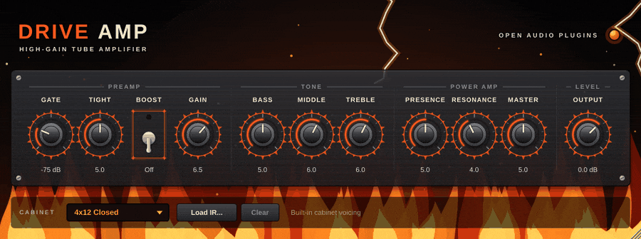
</p>

From chunky crunch to fully saturated, sustaining leads.

| Feature | What it does |
| --- | --- |
| 🔇 **Gate** | Kills hiss between riffs, opens instantly on your pick attack. |
| 🎯 **Tight + Boost** | Trims the low end before the distortion and adds an overdrive-pedal push, for chugs that stay tight. |
| 🔥 **4-stage tube preamp** | Four cascaded tube-style stages, 8x oversampled so the top end stays smooth, not fizzy. |
| 🎚️ **Bass / Middle / Treble** | A model of a real passive amp tone stack, so the knobs interact like on a real amp. |
| 💥 **Presence · Resonance · Master** | Power-amp bite, low-end thump, and power-tube saturation with sag. |
| 🔈 **Cabinet** | Three built-in cabs (4x12, 2x12, 1x12), or load your own impulse response. |

### 💎 OAP Clean Amp: sparkle, glass and bloom

<p align="center">
  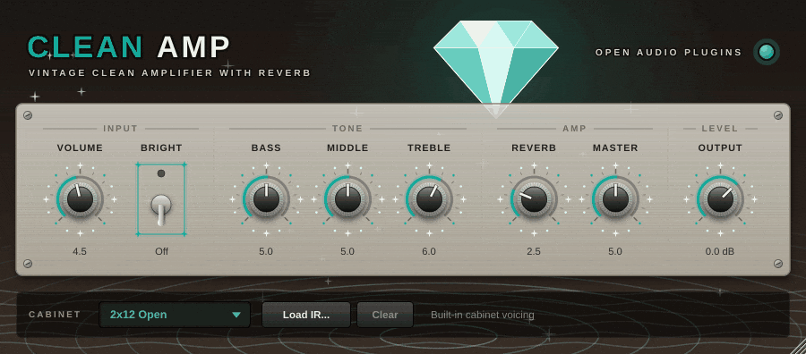
</p>

Pristine cleans that get warm and hairy when you turn the Volume up and dig in.

| Feature | What it does |
| --- | --- |
| ✨ **Bright** | Extra sparkle at low volume. It fades out as you turn up, just like the real circuit. |
| 🔊 **Volume** | Clean up to about 6, then edge-of-break-up territory. |
| 🎚️ **Bass / Middle / Treble** | Blackface-style tone stack: big lows, glassy highs. |
| 🌊 **Reverb** | Stereo room reverb that stays out of the mud. |
| 🫧 **Master** | Power amp with a soft, spongy sag. |
| 🔈 **Cabinet** | 2x12 open-back by default, or bring your own impulse response. |

<a id="effect-amps"></a>
### 🌈 Effect amps: one sound, one plugin

<p align="center">
  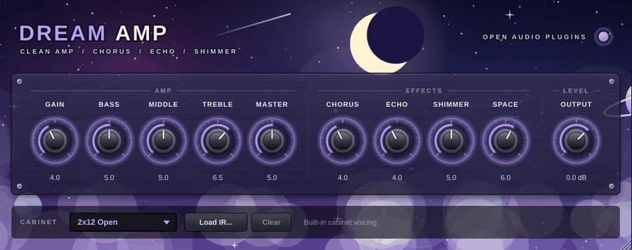
</p>

Each effect amp is a complete rig built around one sound: an amp voiced for the genre, plus the effects it's known for, already dialled in and boiled down to a few knobs. Load one and play.

| Amp | Sounds like | Built-in effects |
| --- | --- | --- |
| 🌌 **Dream Amp** | Glassy dream-pop and ambient cleans | wide chorus, ping-pong echo, shimmer reverb |
| 🌴 **Dub Amp** | Crisp reggae skanks and dub throws | tape echo that runs away, spring |
| 🛸 **Space Delay Amp** | Warm crunch for space rock | three-head tape echo, spring |
| 🖤 **Black Metal Amp** | Cold, trebly buzzsaw | gate, cathedral hall |
| 🥃 **Warm Rock Amp** | British crunch and classic-rock leads | analog delay, plate |
| 🏄 **Surf Amp** | Twangy, drippy instrumentals | spring tank, tremolo |
| 🌫️ **Shoegaze Amp** | A wall of fuzz and wash | fuzz, vibrato, huge hall |
| 🏟️ **Arena Amp** | 80s stadium leads | gate, stereo chorus, ping-pong delay, plate |
| 🎷 **Stereo Jazz Amp** | Pristine solid-state cleans | stereo chorus / vibrato, spring |
| 🌋 **Doom Amp** | Fuzz into a cranked amp, low and slow | gate, fuzz, slow phaser, room |

Every effect amp also has **Gain, Bass, Middle, Treble, Master, Output** and the **cabinet / IR loader**. 📖 [Effect amp manual](docs/plugins/EffectAmps.md)

<a id="pedals"></a>
### 🦶 Pedals: 12 everyday, 8 advanced

<p align="center">
  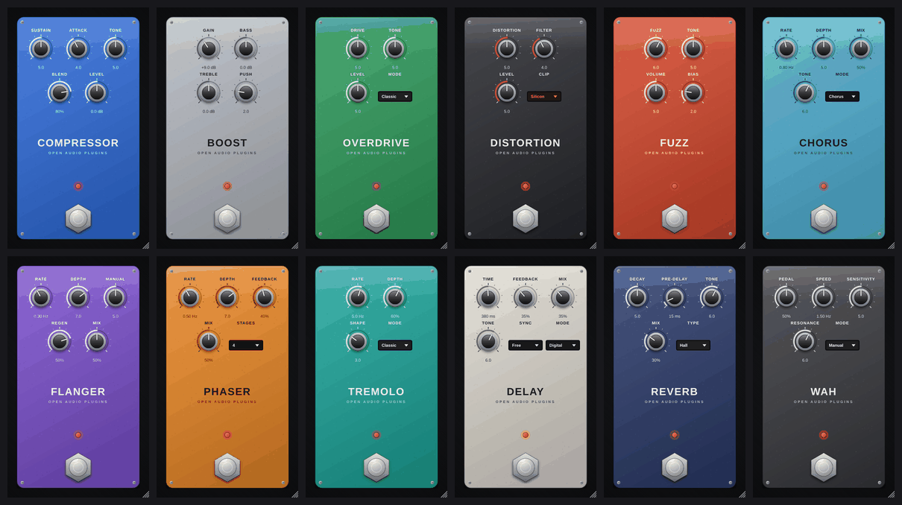
</p>

**Everyday:** Compressor · Boost · Overdrive · Distortion · Fuzz · Chorus · Flanger · Phaser · Tremolo · Delay (tempo sync, analog, ping-pong) · Reverb (room, hall, plate, spring) · Wah (manual, auto, envelope)

<p align="center">
  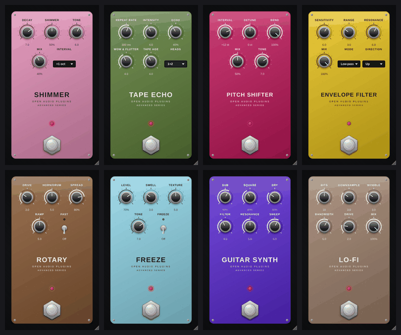
</p>

**Advanced:**

| Pedal | What it does |
| --- | --- |
| ✨ **Shimmer** | Reverb whose tail climbs into octaves: instant cathedral pads. |
| 📼 **Tape Echo** | Three heads, wow and flutter, repeats that run away into self-oscillation. |
| 🎚️ **Pitch Shifter** | Octaves, harmonies and whammy-style bends. |
| 🦆 **Envelope Filter** | Funky auto-wah that follows your picking. |
| 🌀 **Rotary** | Rotating speaker that spins up and down. |
| 🧊 **Freeze** | Holds what you just played as an endless pad. |
| 🎹 **Guitar Synth** | Single notes become a fat analog synth with a sub octave. |
| 📻 **Lo-Fi** | Bit crushing, sample-rate reduction and tape wobble. |

Every pedal has a click-free footswitch that your DAW's bypass button controls too. 📖 [Pedal manual](docs/plugins/Pedals.md)

<a id="pedalboard"></a>
### 🧩 Pedalboard: eight slots, every pedal

<p align="center">
  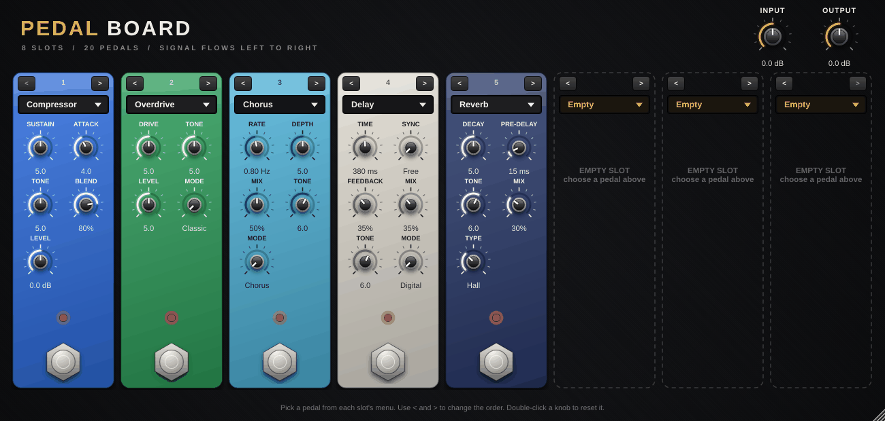
</p>

Pick any pedal for each of eight slots, reorder them with **<** and **>**, switch them on and off, and save the whole board with your project. Also a standalone app for practising. 📖 [Pedalboard manual](docs/plugins/Pedalboard.md)

<details>
<summary><b>Which plugin should I pick?</b></summary>
<br>

| You want… | Pick | Start with |
| --- | --- | --- |
| Metal, djent, hard rock | 🔥 Drive Amp | the defaults, then **Boost** on |
| Classic rock crunch | 🥃 Warm Rock Amp, or 🔥 Drive Amp | the defaults / Drive Amp **Gain** 2-3 |
| Funk, pop, indie cleans | 💎 Clean Amp | the defaults |
| Jazz, new-wave cleans with chorus | 🎷 Stereo Jazz Amp | the defaults |
| Blues, "just breaking up" | 💎 Clean Amp | **Volume** 7-8 |
| Ambient swells, post-rock | 🌌 Dream Amp | **Shimmer** and **Space** up |
| Reggae and dub | 🌴 Dub Amp | automate **Feedback** for dub throws |
| Black metal | 🖤 Black Metal Amp | the defaults |
| Doom, stoner, sludge | 🌋 Doom Amp | **Fuzz** 8, tune low |
| Your own rig | 🧩 Pedalboard → any amp | the default board |

</details>

---

<a id="works-with"></a>
## 🖥️ Works with your DAW

| | 🍎 macOS 12+ | 🪟 Windows 10/11 | 🐧 Linux |
| --- | --- | --- | --- |
| **VST3** | ✓ | ✓ | ✓ |
| **Audio Unit** | ✓ | | |
| **Standalone** (amps, Pedalboard) | ✓ | ✓ | ✓ |

Any DAW that loads VST3 or Audio Units should work, including:

| DAW | macOS | Windows | Linux | Use |
| --- | :---: | :---: | :---: | --- |
| Ableton Live 11 / 12 (incl. Lite) | ✓ | ✓ | | VST3 or AU |
| Logic Pro · GarageBand · MainStage | ✓ | | | AU |
| REAPER | ✓ | ✓ | ✓ | VST3 |
| FL Studio | ✓ | ✓ | | VST3 |
| Cubase · Nuendo | ✓ | ✓ | | VST3 |
| Studio One | ✓ | ✓ | | VST3 or AU |
| Bitwig Studio | ✓ | ✓ | ✓ | VST3 |
| Cakewalk / Sonar | | ✓ | | VST3 |
| Ardour · Mixbus | ✓ | ✓ | ✓ | VST3 |
| Audacity 3.2+ | ✓ | ✓ | ✓ | VST3 |

Not yet: **Pro Tools** (needs AAX) and **iPad/iPhone** (needs AUv3).
Every plugin passes [pluginval](https://github.com/Tracktion/pluginval) at its strictest level; hands-on testing in each DAW is ongoing.
📖 **[Using the plugins in your DAW](docs/DAWS.md)**: rescan steps for each DAW and how to set up a guitar track.

---

<a id="quick-start"></a>
## ⚡ Quick start (if you've done this before)

<p align="center">
  
</p>

**🍎 macOS** (the plugins are copied into your plug-in folders automatically):

```bash
brew install cmake ninja
git clone https://github.com/mitradeniz/FreeAudioFX.git
cd FreeAudioFX
cmake -B build -G Ninja -DCMAKE_BUILD_TYPE=Release
cmake --build build
```

<details>
<summary><b>🪟 Windows</b> (Visual Studio 2022 with "Desktop development with C++", CMake, Git)</summary>
<br>

In a *Developer PowerShell for VS 2022*:

```powershell
git clone https://github.com/mitradeniz/FreeAudioFX.git
cd FreeAudioFX
cmake -B build
cmake --build build --config Release
```

Then, in a PowerShell window opened with **Run as administrator** (from the same folder), copy the plugins into the VST3 folder:

```powershell
Get-ChildItem build\plugins\*\*_artefacts\Release\VST3\*.vst3 |
    Copy-Item -Destination "C:\Program Files\Common Files\VST3" -Recurse -Force
```

</details>

<details>
<summary><b>🐧 Linux</b> (Debian / Ubuntu shown)</summary>
<br>

```bash
sudo apt install build-essential cmake ninja-build pkg-config git \
    libasound2-dev libjack-jackd2-dev libfreetype-dev libfontconfig1-dev \
    libx11-dev libxcomposite-dev libxcursor-dev libxext-dev libxinerama-dev \
    libxrandr-dev libxrender-dev libglu1-mesa-dev mesa-common-dev
git clone https://github.com/mitradeniz/FreeAudioFX.git
cd FreeAudioFX
cmake -B build -G Ninja -DCMAKE_BUILD_TYPE=Release
cmake --build build
mkdir -p ~/.vst3 && cp -r build/plugins/*/*_artefacts/Release/VST3/*.vst3 ~/.vst3/
```

</details>

Then **rescan plug-ins in your DAW** ([how, for each DAW](docs/DAWS.md)) and search for **OAP**. Rock. 🤘

Never used Terminal? No problem, read on. 👇

---

<a id="step-by-step"></a>
## 🪜 Step-by-step guide (macOS)

<p align="center">
  
</p>

This guide walks through a Mac in detail. On Windows or Linux, follow the [quick start](#quick-start) above or the [build guide](docs/BUILDING.md), then continue at [step 7](#step-7).

### ✅ Step 0: Check what you need

| | You need | Notes |
| --- | --- | --- |
| 💻 | A Mac with **macOS 12** or newer | Apple Silicon or Intel |
| 🎹 | A **DAW** that loads VST3 or AU plug-ins | Ableton Live (Lite works too), Logic Pro, GarageBand, REAPER, FL Studio, Cubase, Studio One, Bitwig… ([full list](docs/DAWS.md)) |
| 🎸 | A guitar and an **audio interface** | Or no guitar at all: you can drop a recorded DI clip on a track |
| 💾 | About **3 GB** of free disk space | The JUCE framework and the build files |
| 🌐 | An internet connection | Only for the first build |
| ⏱️ | About **15 minutes** | Mostly waiting for the computer |

### 1️⃣ Open Terminal

Press <kbd>⌘ Cmd</kbd> + <kbd>Space</kbd>, type **Terminal**, press <kbd>Enter</kbd>.

> [!TIP]
> Every grey code box below is a command. Click the copy button in its top-right corner, paste it into Terminal with <kbd>⌘ Cmd</kbd> + <kbd>V</kbd>, then press <kbd>Enter</kbd>.

### 2️⃣ Install Apple's developer tools

```bash
xcode-select --install
```

A window pops up. Click **Install** and wait until it finishes.
If Terminal says *"already installed"*, you're done with this step. 🎉

### 3️⃣ Install Homebrew (skip if you already have it)

Check first:

```bash
brew --version
```

If you see a version number, skip to step 4. If you see *"command not found"*, install Homebrew:

```bash
/bin/bash -c "$(curl -fsSL https://raw.githubusercontent.com/Homebrew/install/HEAD/install.sh)"
```

It asks for your Mac password (you won't see the characters while you type; that's normal).
At the end it prints **"Next steps"** with two or three commands. **Run those too**, so Terminal can find `brew`.

### 4️⃣ Install the build tools

```bash
brew install cmake ninja
```

### 5️⃣ Download the code

```bash
cd ~/Documents
git clone https://github.com/mitradeniz/FreeAudioFX.git
cd FreeAudioFX
```

<sub>Already have the folder? Just `cd` into it and run `git pull` to get the latest version.</sub>

### 6️⃣ Build the plugins

First, prepare the build. This downloads the JUCE framework, so it takes about a minute:

```bash
cmake -B build -G Ninja -DCMAKE_BUILD_TYPE=Release
```

✅ It worked if the last line says **`Build files have been written to: …`**

Now build all 33 plugins. Grab a coffee ☕, the first build takes about 5-20 minutes:

```bash
cmake --build build
```

You'll see a counter like `[57/250] Building CXX object …`. The JUCE framework is compiled once at the start, then each plugin is put together; long quiet stretches are normal, **let it finish.**

<sub>In a hurry? Build just one plugin, for example `cmake --build build --target DreamAmp_All` (all target names are in the [build guide](docs/BUILDING.md#build-just-one-plugin)).</sub>

✅ It worked if Terminal shows your prompt again **without** the word `FAILED`.

The build copies the plugins into your Mac's plug-in folders automatically. Check that they're there:

```bash
ls ~/Library/Audio/Plug-Ins/VST3 ~/Library/Audio/Plug-Ins/Components
```

You should see 33 `OAP … .vst3` plugins and 33 `OAP … .component` plugins, from `OAP Arena Amp` to `OAP Wah`. 🎉

<details>
<summary>🎧 <b>Optional: try an amp without a DAW first</b></summary>
<br>

Every amp and the Pedalboard are also built as standalone apps:

```bash
open "build/plugins/DriveAmp/DriveAmp_artefacts/Release/Standalone/OAP Drive Amp.app"
open "build/plugins/effectamps/DreamAmp_artefacts/Release/Standalone/OAP Dream Amp.app"
open "build/plugins/Pedalboard/Pedalboard_artefacts/Release/Standalone/OAP Pedalboard.app"
```

Click **Options → Audio/MIDI Settings**, pick your audio interface, then unmute the input. **Use headphones** to avoid feedback.

</details>

<a id="step-7"></a>
### 7️⃣ Make your DAW find the plugins

Most DAWs scan for new plug-ins at start-up or have a **Rescan** button. Pick yours:

<details open>
<summary><b>Ableton Live</b> (macOS, Windows)</summary>
<br>

1. Open Live and go to **Settings** (<kbd>⌘ Cmd</kbd> + <kbd>,</kbd>) → **Plug-Ins** tab.
2. Turn **on**: **Use VST3 Plug-In System Folders** and, on a Mac, **Use Audio Units v2**.
3. Click **Rescan**.
4. In the browser on the left, click **Plug-Ins**. You'll find a folder called **Open Audio Plugins**, or just type **OAP** in the search box.

> [!TIP]
> On a Mac you'll see each plugin twice: once as an Audio Unit and once as a VST3. They sound identical, so pick either one.

</details>

<details>
<summary><b>Logic Pro / GarageBand / MainStage</b> (macOS)</summary>
<br>

They use the Audio Unit versions and scan them at launch.
**Logic Pro:** click an empty **Audio FX** slot → **Audio Units → Open Audio Plugins**. Missing? **Logic Pro → Settings → Plug-in Manager**, select it, **Reset & Rescan Selection**.
**GarageBand:** **GarageBand → Settings → Audio/MIDI** → tick **Enable Audio Units**, then in the track's **Smart Controls → Plug-ins**, click an empty slot → **Audio Units → Open Audio Plugins**.

</details>

<details>
<summary><b>REAPER, FL Studio, Cubase, Studio One, Bitwig and others</b></summary>
<br>

| DAW | Rescan |
| --- | --- |
| REAPER | **Options → Preferences → Plug-ins → VST → Re-scan** |
| FL Studio | **Options → Manage plugins → Find installed plugins** |
| Cubase / Nuendo | automatic at start-up (check **Studio → VST Plug-in Manager**) |
| Studio One | automatic at start-up |
| Bitwig Studio | automatic |

More DAWs, Windows and Linux folders: **[docs/DAWS.md](docs/DAWS.md)**.

</details>

### 8️⃣ Set up a guitar track

The idea is the same in every DAW. Here's Ableton Live as the example:

1. **Settings → Audio**: choose your audio interface as the **Audio Input Device** and **Audio Output Device**. Set **Buffer Size** to **128** samples (lower means less delay).
2. Create an audio track: <kbd>⌘ Cmd</kbd> + <kbd>T</kbd>.
3. In the track's **Audio From**, choose **Ext. In**, then the single input your guitar is plugged into (for example **1**, not **1/2**).
4. Set **Monitor** to **In**.
5. Drag an amp (say **OAP Drive Amp** or **OAP Dream Amp**) from the browser onto the track. Want pedals? Drop them on the track **before** the amp, or use the **OAP Pedalboard**.
6. Play! 🤘

<sub>Other DAWs: create a mono audio track with your guitar input, turn on input monitoring, and insert the plugins as track effects. Details in [docs/DAWS.md](docs/DAWS.md#setting-up-a-guitar-track-any-daw).</sub>

> [!IMPORTANT]
> Set your interface's **input gain** so hard strums light its meter green or yellow, **never red**. Too little gain makes the amps sound thin; too much makes them noisy.

### 9️⃣ Have fun

- **Double-click** any knob to reset it.
- Hold **Shift** while dragging for fine adjustments.
- Drag the bottom-right corner to make the window bigger or smaller.
- Try the [tone recipes](#tone-recipes) below as starting points.

---

<a id="tone-recipes"></a>
## 🍳 Tone recipes

Starting points to tweak by ear. Your guitar, pickups and playing will change everything, and that's the fun part.

| Recipe | Amp | Settings |
| --- | --- | --- |
| 🤘 **Modern metal chug** | Drive | Boost **on** · Tight 7 · Gain 6 · Bass 5 · Middle 6 · Treble 6.5 · Presence 6 · Resonance 5 · Master 5 · Gate -60 dB · 4x12 |
| 🎸 **Classic rock crunch** | Drive | Boost off · Tight 4 · Gain 2.5 · Bass 5 · Middle 7 · Treble 6 · Presence 5 · Master 6 · 4x12 |
| 🚀 **Singing lead** | Drive | Boost **on** · Tight 5 · Gain 8 · Middle 7 · Treble 5.5 · Presence 4 · Master 6 · 2x12 |
| 💎 **Glassy clean** | Clean | Volume 3.5 · Bright **on** · Bass 4 · Middle 5 · Treble 7 · Reverb 4 · Master 4 · 2x12 |
| 🎷 **Blues on the edge** | Clean | Volume 7.5 · Bright off · Bass 5 · Middle 6 · Treble 5.5 · Reverb 2 · Master 7 · 1x12 |
| 🕺 **Funk spank** | Clean | Volume 4 · Bright **on** · Bass 3 · Middle 4 · Treble 7.5 · Reverb 1 · Master 5 · 1x12 |
| 🌌 **Ambient swell** | Dream Amp | Gain 3 · Treble 7 · Chorus 5 · Echo 5 · Shimmer 7 · Space 9 (roll your volume knob in) |
| 🌴 **Dub skank** | Dub Amp | Bass 2 · Middle 6 · Treble 7 · Echo Time 375 ms · Feedback 6 · Echo 5 (crank Feedback at the end of a phrase) |
| 🖤 **Tremolo-picked riffs** | Black Metal Amp | Gate -55 dB · Gain 8 · Bass 4 · Middle 3 · Treble 7 · Hall 5 · Decay 8 |
| 🏄 **Surf twang** | Surf Amp | Bass 3 · Treble 8 · Dwell 8 · Reverb 7 · Intensity 0 |

**Pedal chains** (put the pedals before an amp, in this order, or load them into the Pedalboard):

| Recipe | Chain |
| --- | --- |
| 🎛️ **Tight metal** | Boost (Gain 6 dB, Bass -6 dB) → Drive Amp (Boost off) |
| 🔊 **Blues lead** | Compressor (Sustain 4, Blend 60 %) → Overdrive (Drive 4, Level 6) → Clean Amp (Volume 6) → Delay (Analog, 1/4, Mix 25 %) |
| 🌊 **Post-rock wall** | Fuzz → Clean Amp → Tape Echo (Heads 1+2+3) → Shimmer (Mix 50 %) |
| 🎹 **Synth lead** | Guitar Synth (Sub 60 %, Sweep 7) → Phaser → Drive Amp (Gain 3) |
| 🧊 **Pad under a solo** | Freeze (step on it over a chord) → Reverb (Hall) → play the solo on top |

### 🔈 Use your own cabinet (impulse responses)

Have a favourite cab IR? Click **Load IR…** under the amp and pick a `.wav`, `.aiff` or `.flac` file.
Its volume is matched to the built-in cabs automatically, and the file is remembered with your project.
This works on every amp and effect amp.
Want to use a separate cabinet plugin instead? Set **Cabinet** to **Off**.

---

<a id="troubleshooting"></a>
## 🩺 Troubleshooting

<details>
<summary><b>The plugins don't show up in my DAW</b></summary>
<br>

1. Check that the build finished without `FAILED` (step 6).
2. Check the plugin folder. **macOS:** `ls ~/Library/Audio/Plug-Ins/VST3`. **Windows:** `C:\Program Files\Common Files\VST3`. **Linux:** `ls ~/.vst3`. Do you see `OAP Drive Amp.vst3`? On Windows and Linux you copy them there yourself ([quick start](#quick-start)).
3. Rescan in your DAW ([steps for each DAW](docs/DAWS.md)). In **Ableton Live**: **Settings → Plug-Ins**, make sure **Use VST3 Plug-In System Folders** and/or **Use Audio Units v2** is on, then click **Rescan**; hold <kbd>⌥ Option</kbd> while clicking it to force a full rescan.
4. **Logic Pro / GarageBand** only see the Audio Unit (`.component`) versions. **Pro Tools** isn't supported yet (it needs AAX).

</details>

<details>
<summary><b>I don't hear anything</b></summary>
<br>

- Is input monitoring on for the track (Ableton: **Monitor** set to **In**)?
- Is the track's input set to the input your guitar is actually plugged into?
- Is the track's meter moving? If not, the problem is before the amp: check the interface and its input gain.
- Did you turn **Output** on the amp all the way down?

</details>

<details>
<summary><b>I hear my guitar twice, or a clean sound under the amp</b></summary>
<br>

Your audio interface is probably sending the dry guitar straight to your headphones ("direct monitoring"). Turn direct monitoring off on the interface or in its control app.

</details>

<details>
<summary><b>There's a delay between picking and hearing</b></summary>
<br>

Lower your DAW's **Buffer Size** (in its audio settings) to 64 or 128. The plugins themselves add at most about 1 ms, and report it to your DAW.

</details>

<details>
<summary><b>It hisses or hums when I stop playing</b></summary>
<br>

Turn up the **Gate** (Drive Amp, Black Metal, Arena and Doom Amp) until the noise disappears between notes. Single-coil pickups hum near screens. Try turning away from your computer.

</details>

<details>
<summary><b>Crackles and pops</b></summary>
<br>

Raise the **Buffer Size** (256), and close other heavy apps. Make sure you built with `-DCMAKE_BUILD_TYPE=Release` (on Windows: `--config Release`).

</details>

<details>
<summary><b>The build failed</b></summary>
<br>

- `cmake: command not found`: run step 4 again, then open a **new** Terminal window.
- `xcrun: error: invalid active developer path`: run step 2 (`xcode-select --install`).
- Windows: build from a *Developer PowerShell for VS 2022* so CMake finds the compiler.
- Linux: `Package … not found` or missing headers: install the packages from the [quick start](#quick-start).
- Anything else: scroll up to the first line containing `error:`, copy it together with a few lines around it, and [open an issue](https://github.com/mitradeniz/FreeAudioFX/issues).

</details>

<details>
<summary><b>How do I update or uninstall?</b></summary>
<br>

**Update:**

```bash
cd ~/Documents/FreeAudioFX
git pull
cmake --build build
```

Then rescan in your DAW (on Windows and Linux, copy the plugins again first).

**Uninstall:** delete the `OAP …` files from your plug-in folders. macOS: `~/Library/Audio/Plug-Ins/VST3` and `~/Library/Audio/Plug-Ins/Components`. Windows: `C:\Program Files\Common Files\VST3`. Linux: `~/.vst3`.

</details>

<details>
<summary><b>An effect amp's echo keeps going forever</b></summary>
<br>

That's the tape echo self-oscillating (Dub and Space Delay Amp): turn **Feedback** / **Intensity** down and it dies away. It's a feature. 🛸

</details>

---

## 🔬 What's inside

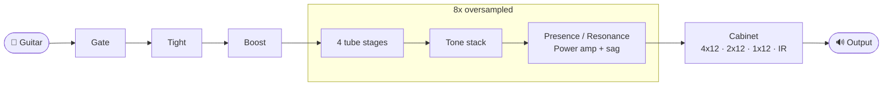

<sub>The OAP Drive Amp signal path. The Clean Amp follows the same idea: Bright, two tube stages, tone stack, Volume, power amp, cabinet and reverb.</sub>

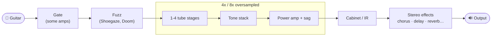

<sub>Every effect amp: one shared engine, configured by a short description of the amp in <a href="shared/amps/AmpModels.cpp"><code>AmpModels.cpp</code></a>.</sub>

- **Mono amps, like real ones.** Stereo input is summed and the amp drives both speakers; reverbs, ping-pong delays and stereo choruses then spread it out.
- **Low latency:** 6 samples for the amps, up to about 1 ms for the oversampled drive pedals, always reported to your DAW for compensation.
- **Light on the CPU** (one core at 48 kHz, measured on an x86 machine): amps 1.5-5 %, effect amps 2.5-7 %, pedals 0.05-3.5 %.
- **Tested:** about 1,000 automated DSP checks (stability at 44.1-192 kHz with random automation, silence, aliasing, levels, impulse responses, every effect amp knob) and every plugin passes [pluginval](https://github.com/Tracktion/pluginval) at its strictest level.

Want to dig deeper? 📚 [Plugin manuals](docs/plugins/) · [Using the plugins in your DAW](docs/DAWS.md) · [Building on every platform](docs/BUILDING.md) · [Developer guide](docs/DEVELOPMENT.md)

### Project structure

```text
FreeAudioFX/
├── plugins/
│   ├── DriveAmp/ CleanAmp/   # the two amps
│   ├── effectamps/           # 10 effect amps, one shared source file
│   ├── pedals/               # 20 pedals, one shared source file
│   └── Pedalboard/
├── shared/
│   ├── dsp/                  # amp building blocks: tubes, tone stacks, cabinets, gate
│   ├── fx/                   # the effects library behind every pedal
│   ├── amps/                 # effect amp models and engine
│   ├── plugin/ ui/           # plugin wrappers, knobs, editors
├── tests/                    # automated DSP tests
├── tools/                    # editor snapshot renderer for the docs
├── docs/                     # manuals, DAW guide, build guide, developer guide, artwork
├── cmake/                    # shared CMake helpers
└── CMakeLists.txt            # top-level build (downloads JUCE automatically)
```

### Built with

**C++17** for the real-time DSP · **[JUCE 9](https://juce.com)** for the plugin formats and UI · **CMake** for reproducible builds · **VST3 / AU** as distribution targets.
Python is used only for side jobs such as generating the README artwork, never inside the plugins.

---

<a id="roadmap"></a>
## 🗺️ Roadmap

- [x] Set up the C++ / JUCE / CMake project template.
- [x] Build the first audio effects (Drive Amp, Clean Amp) and validate them with pluginval.
- [x] Add automated DSP tests.
- [x] 20 pedals (12 everyday, 8 advanced) and a Pedalboard.
- [x] 10 effect amps.
- [ ] Hands-on testing in Ableton Live (incl. Lite), Logic Pro, GarageBand, REAPER, FL Studio, Cubase, Studio One and Bitwig on macOS and Windows, and REAPER/Bitwig/Ardour on Linux.
- [ ] Presets and an input level meter.
- [ ] Pro Tools (AAX) and CLAP builds.
- [ ] Publish the first versioned release with downloadable builds.
- [ ] Expand the collection:
  - 🎚️ **Mixing effects:** EQ, filters and dynamics
  - 🌀 **Creative sound design:** modulation, experimental effects, workflow utilities
  - 🎹 **Virtual instruments:** simple synthesizers and other sound generators
  - 📈 **Audio analysis:** meters, visualizers and diagnostic tools
  - 🤖 **Optional AI-assisted tools**, only where they genuinely help

These are planned areas, not promises of finished features. Each plugin gets its own documentation and release notes when it's ready.

## 🧭 Development principles

1. **Free to use.** Released plugins are intended to be available at no cost.
2. **Transparent.** Features, limitations and dependencies are documented.
3. **Efficient.** Low latency and predictable CPU use come first.
4. **DAW-friendly.** Compatibility, presets and automation are tested before release.
5. **Easy to maintain.** Code and documentation stay organised and approachable.

## 📦 Downloads

No binaries are published yet. Once a plugin is ready, builds and installation instructions will appear in this repository's **Releases** section. Please avoid unofficial download mirrors.

## ⚖️ License

A source-code license has **not been selected yet**. Public visibility does not automatically grant permission to reuse, modify or redistribute the code. Licensing information will be added before the first public source release. Third-party dependencies keep their own licenses.

> [!NOTE]
> JUCE is dual-licensed under the AGPLv3 and a commercial JUCE licence. Releasing these plugins under terms other than the AGPLv3 (for example, closed source) may require a commercial JUCE licence. See the [licensing note](docs/BUILDING.md#licensing-note).

## 👤 Author

**Mitra Deniz Karataş**

If you build a tone you love, or something breaks, [open an issue](https://github.com/mitradeniz/FreeAudioFX/issues). Feedback makes these plugins better. 🎸

---

<sub>Open Audio Plugins is an independent project and is not affiliated with or endorsed by any DAW, plug-in format or amplifier vendor. Product names and trademarks belong to their respective owners. The built-in cabinets and amp voicings are original approximations, not captures of specific commercial products.</sub>
