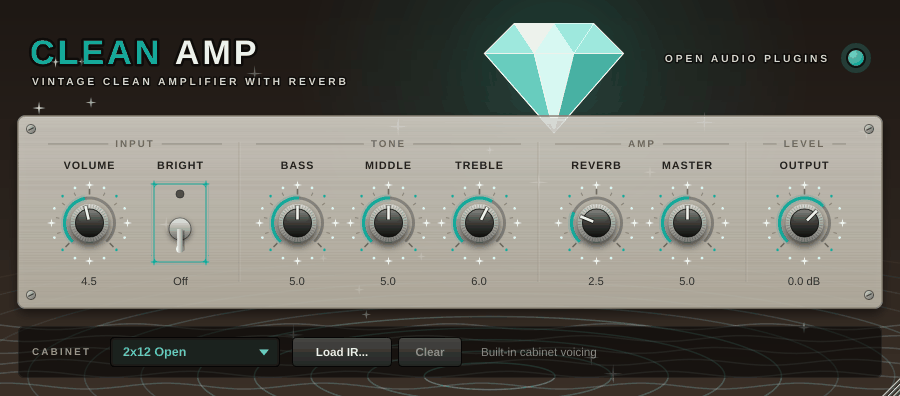

# OAP Clean Amp

<p align="center"></p>

A vintage-style clean amplifier with lots of headroom, a bright switch,
sag-driven power amp compression and a stereo reverb. Turn the Volume up for
warm edge-of-break-up tones.

## Signal flow

```text
input ─ Bright ─ V1 ─ tone stack ─ Volume ─ V2 ─ power amp (sag) ─ cabinet ─ Output ─ Reverb (stereo)
                 └─────────────── 4x oversampled ──────────────┘
```

- **V1 / V2:** two tube-style gain stages. V1 stays clean; V2 starts to break up
  when Volume goes past about 6.
- **Tone stack:** model of the passive treble/middle/bass network with
  American "blackface"-style values - big lows, sparkling highs and the
  characteristic mid scoop.
- **Power amp:** push-pull saturation with strong power-supply sag, for the
  soft compression and bloom of a tube-rectified amp.
- **Reverb:** room-style stereo reverb, filtered so it doesn't muddy the lows or
  fizz in the highs.

## Controls

| Control | Range | What it does |
| --- | --- | --- |
| Volume | 0-10 | Preamp level. Low = pristine clean, high = break-up. |
| Bright | On/Off | Bright cap: adds sparkle at low Volume settings and fades out as Volume goes up, like the real circuit. |
| Bass / Middle / Treble | 0-10 | Passive tone stack. |
| Reverb | 0-10 | Reverb amount. |
| Master | 0-10 | Power amp drive: more compression and sag as it goes up. |
| Output | -24 ... +12 dB | Final level (before the reverb). |
| Cabinet | Off, 4x12 Closed, 2x12 Open, 1x12 Combo, User IR | Speaker cabinet. |

Double-click a knob to reset it. Hold **Shift** while dragging for fine control.

## Tips

- Sparkling clean: Volume 3-4, **Bright** on, Treble 6-7, Reverb 3-4.
- Edge of break-up: Volume 7-8, Master 6-7, Bright off; dig in with the pick to
  make it growl and play softly to clean up.
- The **2x12 Open** cabinet (default) suits clean tones; **1x12 Combo** is
  tighter and boxier.

## Technical

- Mono amp with a stereo reverb (on a stereo track the output is stereo).
- 4x oversampling (polyphase IIR) for the non-linear stages.
- Latency: about 6 samples, reported to the host. Tail: 3 s (reverb).
- CPU: about 1.5 % of one core at 48 kHz (measured on an x86 cloud machine).
