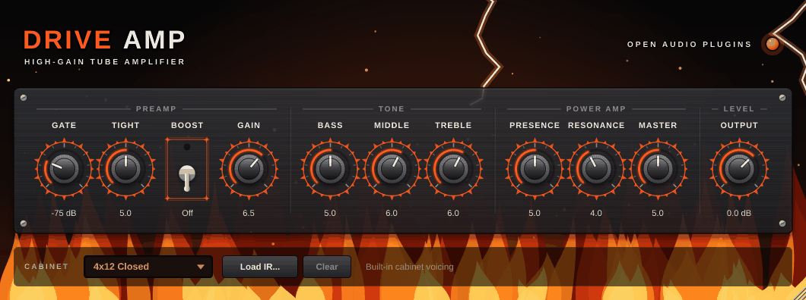

# OAP Drive Amp

<p align="center"></p>

A high-gain guitar amplifier: tight, saturated rhythm tones through to
sustaining leads, with a built-in noise gate, an overdrive-style boost and a
cabinet stage that accepts your own impulse responses.

## Signal flow

```text
input ─ Gate ─ Tight ─ [Boost] ─ preamp (4 triode stages) ─ tone stack ─ Resonance/Presence ─ power amp ─ cabinet ─ Output
                                 └──────────────────── 8x oversampled ─────────────────────────────┘
```

- **Preamp:** four cascaded gain stages, each with its own coupling high-pass,
  bandwidth limit and asymmetric tube-style curve. The second stage is
  biased "cold" for the aggressive, compressed character of modern high-gain
  amps.
- **Tone stack:** a model of the classic passive treble/middle/bass network
  (British-style component values), so the controls interact like they do on a
  real amp.
- **Power amp:** push-pull saturation with power-supply sag, plus Presence and
  Resonance (the low-end "thump" control found on many high-gain heads).
- **Cabinet:** built-in voicings or a loaded impulse response.

## Controls

| Control | Range | What it does |
| --- | --- | --- |
| Gate | Off, -90 ... -30 dB | Noise gate threshold. Opens instantly on the pick attack, closes smoothly. Fully left = off. |
| Tight | 0-10 | Low cut before the distortion (20-250 Hz). Higher = tighter palm mutes. |
| Boost | On/Off | Overdrive-pedal style boost: cuts lows, pushes the mids, adds +8 dB of drive. |
| Gain | 0-10 | Preamp gain, from crunch to fully saturated. |
| Bass / Middle / Treble | 0-10 | Passive tone stack. Middle at 0 gives the classic scoop. |
| Presence | 0-10 | Upper-treble bite in the power amp. |
| Resonance | 0-10 | Low-end thump around 95 Hz in the power amp. |
| Master | 0-10 | Power amp drive. Higher settings add power-tube saturation and sag. |
| Output | -24 ... +12 dB | Final level. |
| Cabinet | Off, 4x12 Closed, 2x12 Open, 1x12 Combo, User IR | Speaker cabinet. |

Double-click a knob to reset it. Hold **Shift** while dragging for fine control.

## Cabinets and impulse responses

The built-in cabinets are filter-based approximations of typical guitar cab
responses (not captures of any specific product). They have zero latency and
are level-matched with each other.

**Load IR...** accepts `.wav`, `.aiff` or `.flac` impulse responses (mono or
stereo, any sample rate, up to 1 second). The IR is level-matched to the
built-in cabinets so switching doesn't jump in volume, and the file path is
saved with your project. Choose *Off* to use an external cabinet plugin.

## Tips

- Start with the defaults, set **Gate** just above where the hiss disappears
  when you stop playing.
- For modern metal: **Boost** on, **Tight** 6-7, **Gain** 5-7. Extra gain on
  top of the boost mostly adds noise.
- Scooped tones sound big alone but disappear in a mix - keep **Middle** at 4 or
  more for band recordings.

## Technical

- Mono amp; stereo input is summed, output goes to all channels.
- 8x oversampling (polyphase IIR) for the non-linear stages.
- Latency: about 6 samples, reported to the host.
- CPU: about 4 % of one core at 48 kHz (measured on an x86 cloud machine).
- Parameters are smoothed; the cabinet selector crossfades.
