# OAP Effect Amps

<p align="center"></p>

Complete "amp + effects" plugins, each built around one sound and dressed in
its own artwork. Every effect amp is a tube-style amp head with its own voicing,
plus the effects that sound is known for, already dialled in and reduced to a
few knobs. Load one, play, done.

| Plugin | Sound | Built-in effects | Gate |
| --- | --- | --- | --- |
| [Dream Amp](#dream-amp) | Glassy clean, dream pop, ambient | stereo chorus, ping-pong echo, shimmer reverb | |
| [Dub Amp](#dub-amp) | Reggae skank, dub | tape echo, spring | |
| [Space Delay Amp](#space-delay-amp) | Warm crunch, space rock | three-head tape echo, spring | |
| [Black Metal Amp](#black-metal-amp) | Cold buzzsaw high gain | hall reverb | ✓ |
| [Warm Rock Amp](#warm-rock-amp) | British crunch, classic rock | analog delay, plate | |
| [Surf Amp](#surf-amp) | Bright twangy clean | spring tank, tremolo | |
| [Shoegaze Amp](#shoegaze-amp) | Fuzz wall, noise pop | fuzz, vibrato, huge hall | |
| [Arena Amp](#arena-amp) | 80s hot-rod lead | stereo chorus, ping-pong delay, plate | ✓ |
| [Stereo Jazz Amp](#stereo-jazz-amp) | Solid-state clean, jazz, funk | stereo chorus/vibrato, spring | |
| [Doom Amp](#doom-amp) | Fuzz into a cranked amp, doom, stoner | fuzz, slow phaser, room | ✓ |
| [Crunch Amp](#crunch-amp) | Plexi-style crunch, rock'n'roll, punk | treble booster, room | |
| [8-Bit Amp](#8-bit-amp) | Chiptune, game music, lo-fi | square-wave synth, bit crusher, echo | |
| [Knight Amp](#knight-amp) | Heroic power-metal lead | harmony voice, ping-pong echo, hall | ✓ |
| [Heavy Metal Amp](#heavy-metal-amp) | 80s heavy metal | tight boost, delay, plate | ✓ |
| [Synthwave Amp](#synthwave-amp) | Neon 80s clean | wide chorus, flanger, tempo-synced echo, plate | |
| [Western Amp](#western-amp) | Twang, spaghetti western, rockabilly | slapback, tremolo, spring | |
| [Funk Amp](#funk-amp) | Funk, disco, neo-soul | compressor, envelope filter, phaser | |
| [Pharaoh Amp](#pharaoh-amp) | Desert crunch | tape echo, slow phaser, temple hall | |
| [Sakura Amp](#sakura-amp) | City pop, J-rock cleans | compressor, chorus, echo, plate | |
| [Persian Amp](#persian-amp) | Silky clean with octave sparkle | octave-up voice, echo, palace hall | |
| [Choir Amp](#choir-amp) | Heavenly swells, worship, ambient | choir shimmer, cathedral reverb | |

## How every effect amp works

```text
input ─ [Gate] ─ [pedals, if built in] ─ voicing EQ ─ tube preamp ─ tone stack ─ power amp ─ cabinet ─ stereo effects ─ Output
                                                    └──────── 4x or 8x oversampled ────────┘
```

- **The amp section is mono**, like a real amp. The effects after the cabinet
  run in **stereo**, so chorus, ping-pong delays and reverbs spread across
  both speakers on a stereo track.
- **Pedal-type effects** sit in front of the amp, like on a pedalboard: the
  fuzz (Shoegaze, Doom), the boosts (Crunch, Heavy Metal), the synth
  (8-Bit), and the compressor and envelope filter (Funk, Sakura).
- The **effects come after the cabinet**, like a studio effects rack, so
  delays and reverbs stay clean and wide instead of being distorted by the amp.

### Controls on every effect amp

| Control | Range | What it does |
| --- | --- | --- |
| Gate *(some amps)* | Off, -89 ... -30 dB | Noise gate threshold. Fully left switches it off. |
| Gain | 0-10 | How hard the preamp is driven. |
| Bass / Middle / Treble | 0-10 | Passive amp tone stack: the knobs interact like on a real amp. |
| Master | 0-10 | Power amp drive: more compression, sag and bloom as it goes up. |
| *Effect knobs* | | Two to five per amp, see below. |
| Output | -24 ... +12 dB | Final level. |
| Cabinet | Off, 4x12 Closed, 2x12 Open, 1x12 Combo, User IR | Speaker cabinet. **Load IR…** loads your own impulse response. |

Double-click a knob to reset it, hold **Shift** while dragging for fine
control, and drag the window's corner to resize it. The rings drawn around the
knobs are part of each amp's artwork. The amps are level-matched:
clean amps sit around -19 dB RMS and driven ones around -15 dB RMS with a
typical guitar DI, so switching amps doesn't blast you.

---

## Dream Amp

<p align="center"></p>

A glassy clean amp floating in a wide chorus, ping-pong echoes and an
octave-up shimmer reverb. Instant dream pop and ambient swells.

| Effect knob | What it does |
| --- | --- |
| Chorus | Wide stereo chorus: amount and depth. |
| Echo | Ping-pong echo level and number of repeats. |
| Shimmer | How much of the reverb tail rises an octave. |
| Space | Reverb size and level: from a room to endless. |

**Try:** Gain 3, Treble 7, Chorus 5, Echo 5, Shimmer 7, Space 9. Play slow chords and let them ring.

## Dub Amp

<p align="center"></p>

A tight, bright clean amp for reggae skanks (the low end is trimmed before the
preamp so offbeat chops stay crisp) with a dub tape echo you can push into
endless repeats, and a short spring reverb.

| Effect knob | What it does |
| --- | --- |
| Echo Time | 120-700 ms. |
| Feedback | Number of repeats. At the very top the echo runs away into self-oscillation: automate it for dub throws. |
| Echo | Echo level. |
| Spring | Spring reverb amount. |

**Try:** Bass 2, Middle 6, Treble 7, Echo Time 375 ms (a dotted eighth at 120 BPM), Feedback 6, Echo 5.

## Space Delay Amp

<p align="center"></p>

A warm crunch amp with a three-head tape echo and a spring reverb built in,
from slapback to self-oscillating space trips.

| Effect knob | What it does |
| --- | --- |
| Repeat Rate | Tape speed: 50-700 ms between repeats (all heads move together). |
| Intensity | Repeats. High settings self-oscillate. |
| Echo | Echo level. |
| Heads | Which playback heads you hear: 1, 2, 3, 1+2, 2+3 or 1+2+3, for different rhythmic patterns. |
| Reverb | Spring reverb amount. |

**Try:** Gain 4, Repeat Rate 300 ms, Heads 1+2+3, Intensity 6 and slowly turn it up while you hold a chord.

## Black Metal Amp

<p align="center"></p>

Thin, cold and razor sharp: a trebly buzzsaw high-gain amp with scooped mids,
a fast gate and a dark cathedral hall for tremolo-picked riffs.
Oversampled 8x so the extreme gain stays smooth.

| Effect knob | What it does |
| --- | --- |
| Hall | Hall reverb amount. |
| Decay | Hall length, up to cathedral. |

**Try:** Gate -55 dB, Gain 8, Bass 4, Middle 3, Treble 7, Hall 5, Decay 8.

## Warm Rock Amp

<p align="center"></p>

A warm British-style crunch amp, from rhythm crunch to singing classic-rock
leads, with an analog-style delay and a studio plate reverb.

| Effect knob | What it does |
| --- | --- |
| Delay | Analog delay level and repeats. |
| Delay Time | 80-900 ms. |
| Plate | Plate reverb amount. |

**Try:** rhythm with Gain 4, Delay 0, Plate 2; lead with Gain 8, Middle 7, Delay 4 at 450 ms, Plate 3.

## Surf Amp

<p align="center"></p>

Sparkling clean tone drenched in a drippy spring reverb tank, with an
amp-style tremolo. Made for twangy instrumentals.

| Effect knob | What it does |
| --- | --- |
| Dwell | How hard the spring tank is driven: longer, drippier tails. |
| Reverb | Spring reverb level. |
| Speed | Tremolo speed, 1-12 Hz. |
| Intensity | Tremolo depth (0 = off). |

**Try:** Bass 3, Treble 8, Dwell 8, Reverb 7, Intensity 0. Pick hard on the low strings near the bridge.

## Shoegaze Amp

<p align="center"></p>

A wall of fuzz into a cranked amp, warbling vibrato and a huge washed-out
hall: shoegaze and noise pop in one box.

| Effect knob | What it does |
| --- | --- |
| Fuzz | Fuzz pedal in front of the amp (level-compensated). |
| Warble | Vibrato depth: from gentle detune to seasick pitch bends. |
| Wash | Hall reverb amount. |
| Size | Hall length. |

**Try:** Fuzz 7, Warble 5, Wash 8, Size 9, Treble 5. Strum big open chords and bend the neck.

## Arena Amp

<p align="center"></p>

The big 80s rack sound: a hot-rodded lead amp into a stereo chorus, a
ping-pong delay and a plate reverb. Oversampled 8x, with a gate.

| Effect knob | What it does |
| --- | --- |
| Chorus | Stereo chorus amount. |
| Delay | Ping-pong delay level and repeats (about 430 ms). |
| Reverb | Plate reverb amount. |

**Try:** Gain 7, Middle 6, Treble 6.5, Chorus 4, Delay 5, Reverb 4. Play a solo with lots of vibrato.

## Stereo Jazz Amp

<p align="center"></p>

A pristine solid-state clean amp with a lush built-in stereo chorus and
vibrato. Jazz chords, funk and new-wave cleans. It stays clean almost all the
way up.

| Effect knob | What it does |
| --- | --- |
| Speed | Chorus/vibrato speed, 0.1-6 Hz. |
| Depth | Modulation depth (0 = dry). |
| Vibrato | Off: stereo chorus. On: pitch vibrato. |
| Reverb | Spring reverb amount. |

**Try:** Gain 4, Bass 6, Treble 5, Speed 0.6 Hz, Depth 6 for chorus; Vibrato on with Speed 5 Hz and Depth 4 for a warbly vibrato.

## Doom Amp

<p align="center"></p>

Low and slow: a thick fuzz into a cranked, saggy amp with a huge low end, a
slow phaser and a dark room. Stoner, doom and sludge.

| Effect knob | What it does |
| --- | --- |
| Fuzz | Fuzz pedal in front of the amp (level-compensated). |
| Phase | Phaser amount (0 = off). |
| Phase Speed | 0.05-2 Hz. |
| Room | Room reverb amount. |

**Try:** Gate -60 dB, Fuzz 8, Gain 6, Bass 7, Treble 4, Phase 4 at 0.15 Hz. Tune down and play slowly.

## Crunch Amp

<p align="center">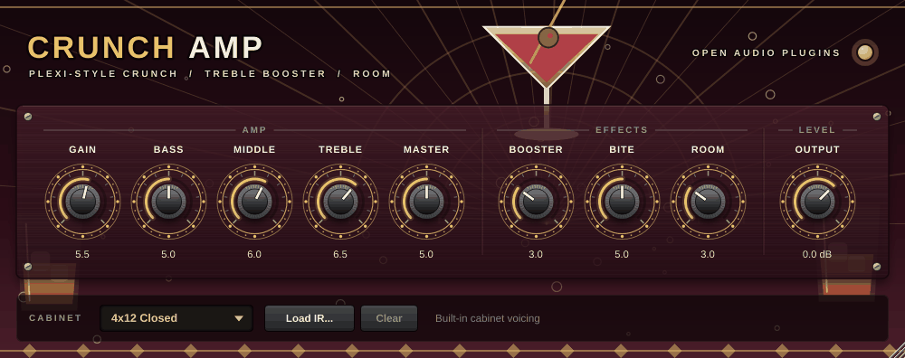</p>

A loud, open crunch amp in the spirit of late-60s plexi heads, with a treble
booster in front for extra bite and a small room around it. Rock'n'roll, blues
rock and punk. Dressed for a late-night cocktail bar.

| Effect knob | What it does |
| --- | --- |
| Booster | Treble booster in front of the amp (0 = no boost). |
| Bite | The booster's treble: from warm to cutting. |
| Room | Small room reverb. |

**Try:** Gain 7, Booster 5, Bite 6, Room 2. Back your guitar's volume off for a cleaner sound.

## 8-Bit Amp

<p align="center">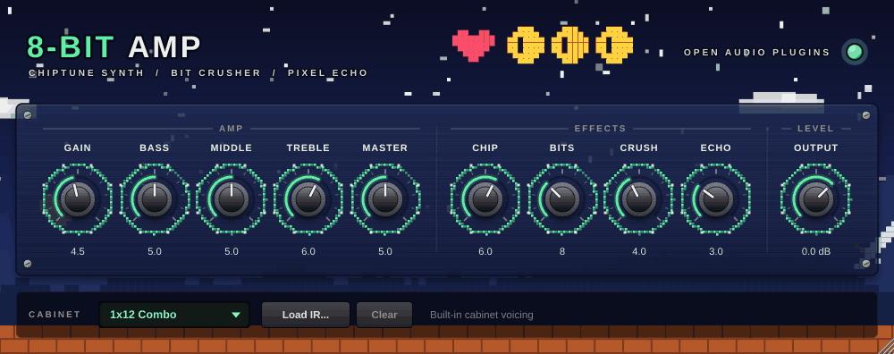</p>

Turns your guitar into a retro game console: a square-wave synth with a sub
octave, a crunchy little amp, a bit crusher and a pixel-perfect echo.
Chiptune, game-music covers and lo-fi beats.

| Effect knob | What it does |
| --- | --- |
| Chip | Square-wave synth and sub octave mixed with your guitar (0 = just guitar). |
| Bits | Bit depth, 4-16: lower is grittier. |
| Crush | Sample-rate reduction. |
| Echo | Echo level. |

**Try:** Chip 8, Bits 6, Crush 5, Echo 4. Play single-note melodies high on the neck: the synth follows one note at a time.

## Knight Amp

<p align="center">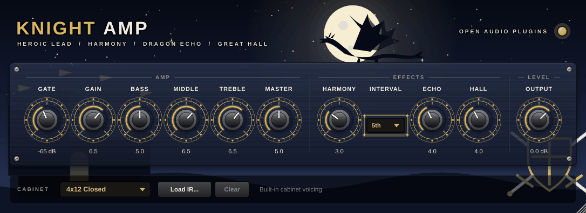</p>

A heroic, singing lead amp for power metal and epic rock, with a built-in
harmony voice, a sweeping ping-pong echo and a great-hall reverb. Oversampled
8x, with a gate.

| Effect knob | What it does |
| --- | --- |
| Harmony | Level of the harmony voice. |
| Interval | Min 3rd, Maj 3rd, 4th, 5th or Octave above what you play. |
| Echo | Ping-pong echo level and repeats. |
| Hall | Hall reverb amount and length. |

The harmony is a fixed interval, not a key-aware harmonizer: fifths and
octaves fit everywhere, thirds fit melodies in the matching key.

**Try:** Gain 7, Harmony 5, Interval 5th, Echo 5, Hall 5. Solo away.

## Heavy Metal Amp

<p align="center">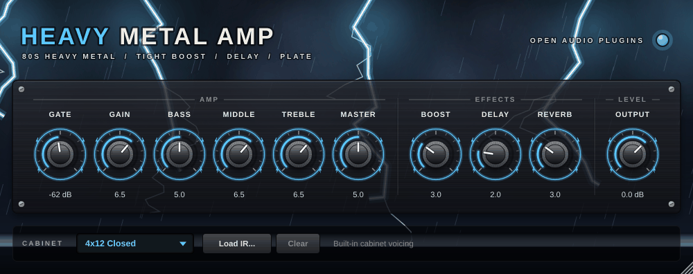</p>

Leather, chrome and lightning: a tight, mid-forward 80s heavy metal amp with a
gate, a tight boost in front, a solo delay and a plate reverb. Galloping riffs
and screaming solos. Oversampled 8x.

| Effect knob | What it does |
| --- | --- |
| Boost | Tight boost in front of the amp: more drive and less flub (0 = no boost). |
| Delay | Solo delay level and repeats (about 420 ms). |
| Reverb | Plate reverb amount. |

**Try:** Gate -55 dB, Gain 7, Boost 5, Middle 7, Treble 6.5; Delay 0 for riffs, 4 for solos.

## Synthwave Amp

<p align="center">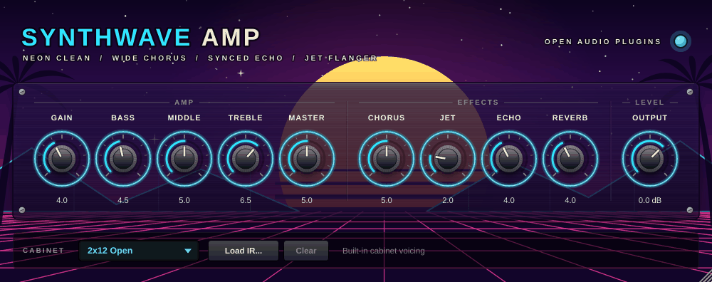</p>

Neon nights on the coast highway: a glassy 80s clean amp with a wide stereo
chorus, a jet flanger, a dotted-eighth echo that follows your DAW's tempo and a
big plate.

| Effect knob | What it does |
| --- | --- |
| Chorus | Wide stereo chorus. |
| Jet | Slow flanger sweep (0 = off). |
| Echo | Ping-pong echo, dotted eighths at your project's tempo. |
| Reverb | Plate reverb amount. |

**Try:** Gain 3.5, Treble 7, Chorus 6, Echo 5, Reverb 5. Arpeggiate chords in time with the echo.

## Western Amp

<p align="center">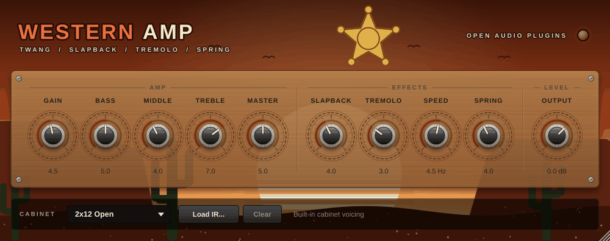</p>

Dust, sunsets and big low strings: a twangy clean amp with a slapback echo, amp
tremolo and a spring reverb. Spaghetti-western themes, rockabilly and desert
rock.

| Effect knob | What it does |
| --- | --- |
| Slapback | Short single echo (about 115 ms). |
| Tremolo | Tremolo depth (0 = off). |
| Speed | Tremolo speed, 1-12 Hz. |
| Spring | Spring reverb amount. |

**Try:** Gain 4, Bass 6, Treble 7, Slapback 5, Tremolo 4 at 5 Hz, Spring 5. Play melodies on the low strings.

## Funk Amp

<p align="center">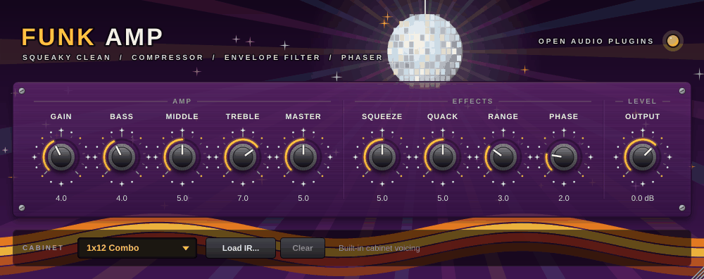</p>

Disco-ball cleans: a bright, punchy clean amp with a squashy compressor and an
envelope filter that quacks with your picking, plus a phaser. Funk, disco and
neo-soul.

| Effect knob | What it does |
| --- | --- |
| Squeeze | Compressor amount. |
| Quack | Envelope filter amount and sensitivity (0 = off). |
| Range | Where the filter sweep starts. |
| Phase | Phaser amount (0 = off). |

**Try:** Squeeze 6, Quack 7, Range 3, Phase 2. Play muted sixteenth-note strums.

## Pharaoh Amp

<p align="center">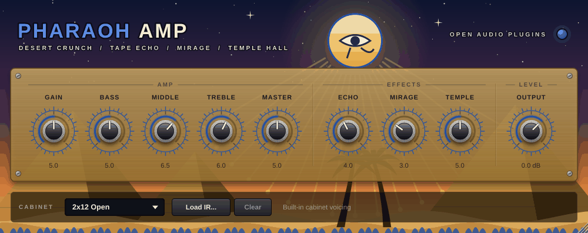</p>

A warm, nasal desert crunch with an oud-like bite in the mids, a two-head tape
echo, a slow mirage phaser and the reverb of a stone temple.

| Effect knob | What it does |
| --- | --- |
| Echo | Tape echo level and repeats. |
| Mirage | Slow phaser amount (0 = off). |
| Temple | Hall reverb amount and length. |

**Try:** Gain 6, Middle 7, Echo 5, Mirage 4, Temple 6. Play melodies on one string with slides.

## Sakura Amp

<p align="center">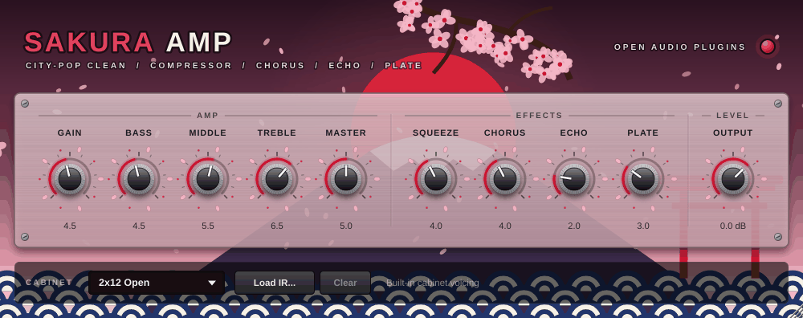</p>

Cherry blossoms and late-night drives: a polished, glassy clean amp with a
gentle compressor, a shimmering chorus, a soft echo and a plate reverb. City
pop, J-rock cleans and anime openings.

| Effect knob | What it does |
| --- | --- |
| Squeeze | Compressor amount. |
| Chorus | Chorus amount. |
| Echo | Echo level. |
| Plate | Plate reverb amount. |

**Try:** Gain 4, Treble 7, Squeeze 5, Chorus 5, Echo 3, Plate 4. Big major-seventh chords.

## Persian Amp

<p align="center">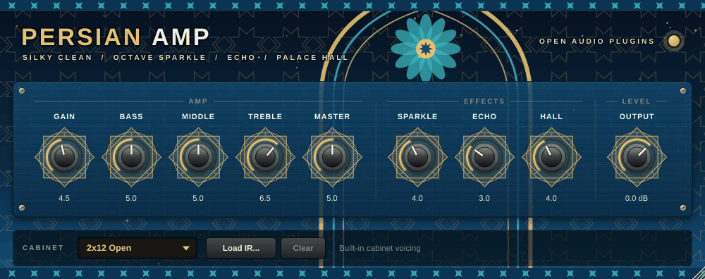</p>

Turquoise tiles and golden light: a bright, silky clean amp with an octave-up
sparkle reminiscent of a hammered santur, a soft echo and a palace hall.

| Effect knob | What it does |
| --- | --- |
| Sparkle | Level of the octave-up voice. |
| Echo | Echo level. |
| Hall | Hall reverb amount and length. |

**Try:** Gain 4, Treble 6.5, Sparkle 5, Echo 3, Hall 5. Fast tremolo picking on single notes.

## Choir Amp

<p align="center">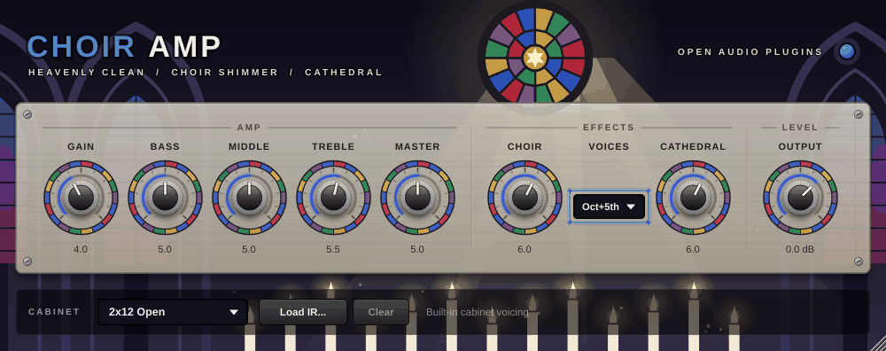</p>

Light through stained glass: a soft, warm clean amp whose reverb rises into a
choir of octaves and fifths, inside an endless cathedral. Worship, ambient and
post-rock swells.

| Effect knob | What it does |
| --- | --- |
| Choir | How much of the reverb rises into the choir. |
| Voices | Octave, Fifth, Oct+5th or 2 Oct: the pitches the choir sings. |
| Cathedral | Cathedral reverb amount and length. |

**Try:** Gain 3, Choir 8, Voices Oct+5th, Cathedral 8. Let chords ring and swell them in with your volume knob.

---

## Technical

- Mono amp, stereo effects after the cabinet (mono in, stereo out works best).
- 4x oversampling (8x on Black Metal, Arena, Knight and Heavy Metal), polyphase IIR.
- Latency: 6 samples, or 45 samples on the amps with a built-in fuzz or boost
  (Shoegaze, Doom, Crunch, Heavy Metal). Always reported to the host for compensation.
- CPU: about 2-8 % of one core at 48 kHz, measured on an x86 cloud machine.
- Tails of up to 20 s (reverbs and echoes), reported to the host.
- Every amp is described by one entry in
  [`shared/amps/AmpModels.cpp`](../../shared/amps/AmpModels.cpp), and its
  artwork is generated by [`tools/art/make_amp_art.py`](../../tools/art/make_amp_art.py);
  see the [developer guide](../DEVELOPMENT.md#adding-an-effect-amp) to make your own.
