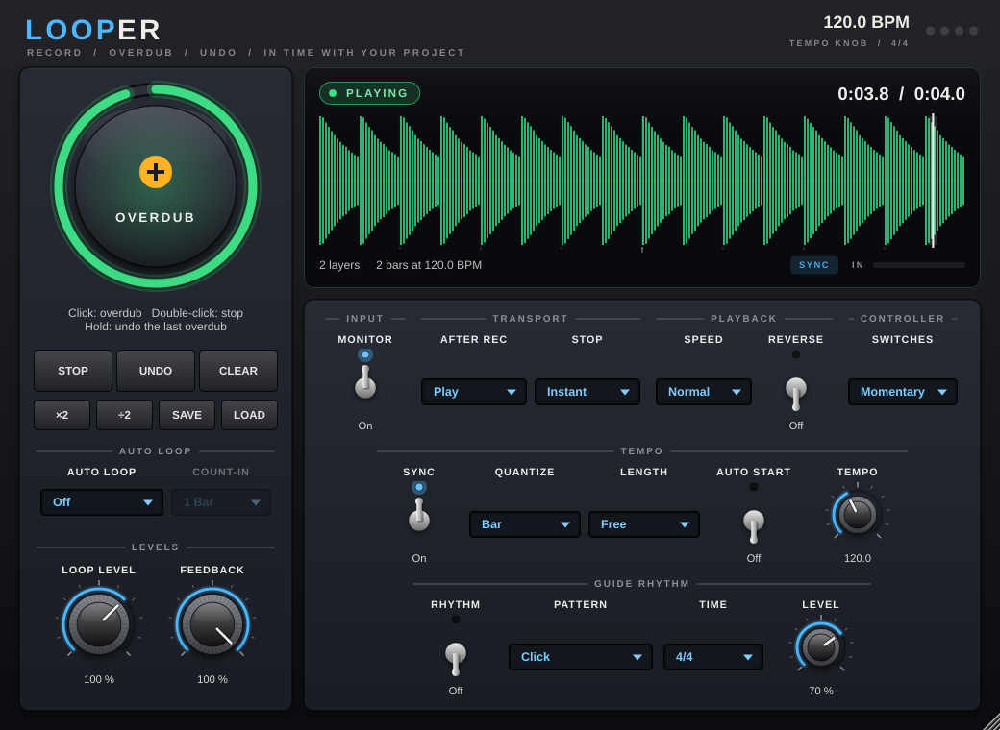
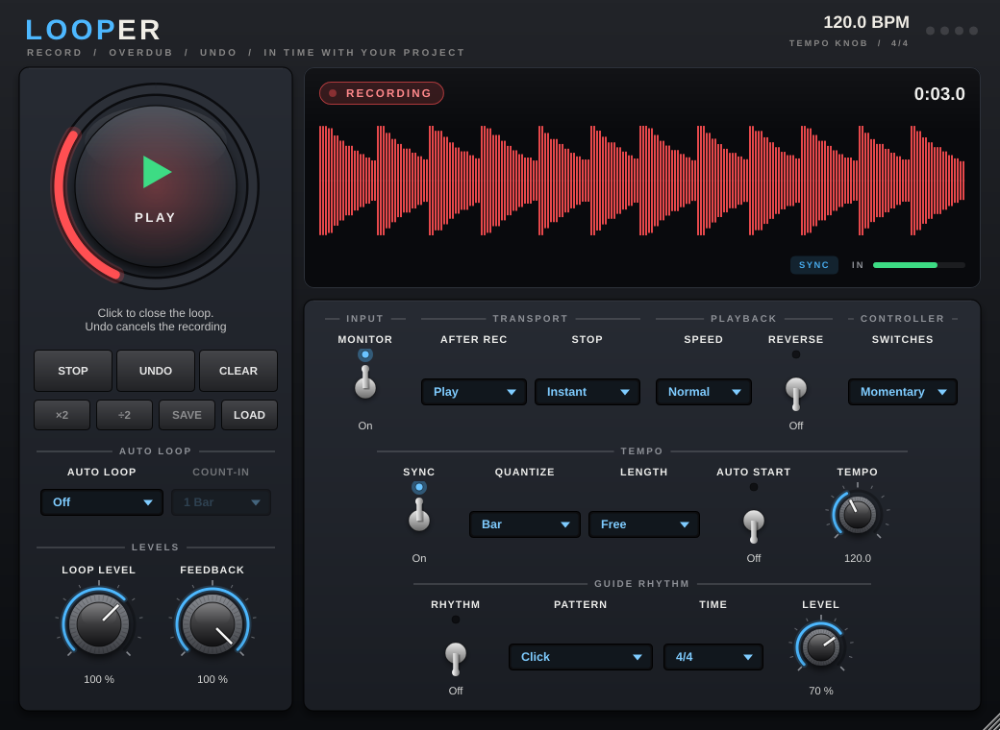
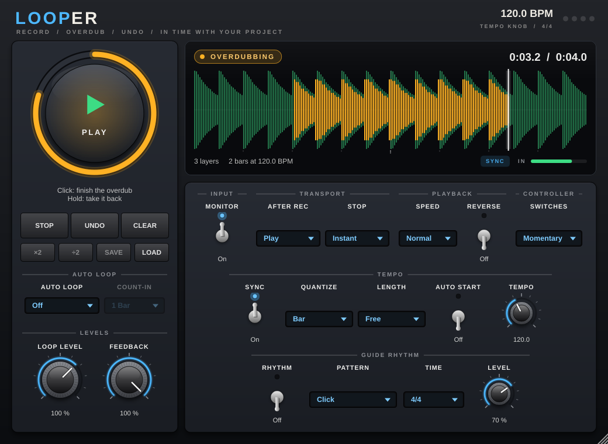
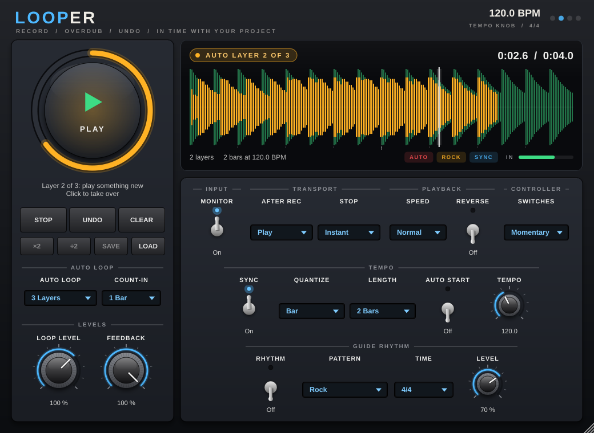
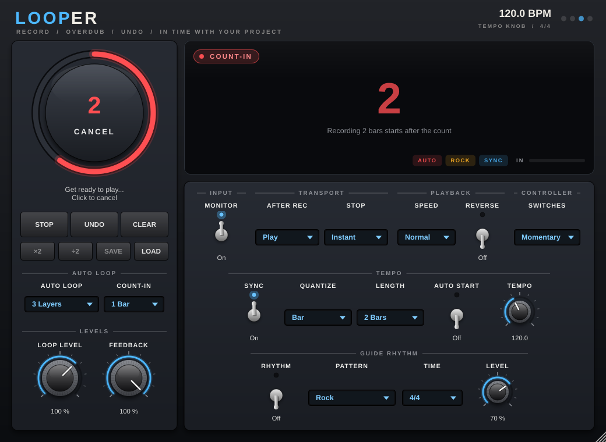

# OAP Looper

Record a phrase, let it repeat, and play over it: layer after layer, with
undo. The Looper works like the loopers guitarists know from the floor, plus
what software does better: a waveform you can see, loops that lock to your
project's tempo, exact lengths in beats and bars, a guide rhythm (clicks or
drum grooves), an **auto loop** that counts you in and records layer after
layer without another click, and the loop is **saved with your project**.

- [Quick start](#quick-start)
- [The big button](#the-big-button)
- [The other buttons](#the-other-buttons)
- [The display](#the-display)
- [Settings](#settings)
- [In time with your project](#in-time-with-your-project)
- [Auto loop: hands on the guitar](#auto-loop-hands-on-the-guitar)
- [The guide rhythm](#the-guide-rhythm)
- [Your loop is saved with the project](#your-loop-is-saved-with-the-project)
- [Audio files](#audio-files)
- [Foot controllers and automation](#foot-controllers-and-automation)
- [Good to know](#good-to-know)

## Quick start

1. Put **OAP Looper** on your guitar track, **after the amp** (and after any
   pedals). That way the loop holds the finished sound, and you can change
   your tone for the next layer without changing what is already recorded.
2. Play something and **click the big button** when the phrase starts.
3. **Click again** when the phrase is over. The loop plays, and keeps playing.
4. **Click again** to record on top of it (*overdub*), and once more to stop
   recording. Repeat as often as you like.
5. Not happy with the last layer? **Hold** the big button (or click **UNDO**).
6. **Double-click** the big button (or click **STOP**) to stop the loop.

> [!TIP]
> Timing the two clicks is the whole art of looping: click **on** the first
> beat of the phrase, and again **on** the first beat of the repeat, as if you
> were tapping your foot. If you'd rather let the Looper cut the loop for
> you, see [In time with your project](#in-time-with-your-project), or set
> **Auto Loop** to *1 Layer* or more: one click, a count-in, and the Looper
> records and layers in time by itself
> ([Auto loop](#auto-loop-hands-on-the-guitar)).

## The big button

The big round button is the looper's footswitch. A click, a double-click and
a hold each mean something, and the label in its middle always says what the
next click does. The ring around it shows where the loop is.

| The looper is | Click | Double-click | Hold (0.8 s) |
| --- | --- | --- | --- |
| **Empty** | Start recording | | |
| **Recording** | Close the loop and play it | | |
| **Playing** | Start an overdub | Stop | Undo the last overdub (hold again: redo) |
| **Overdubbing** | Finish the overdub | Finish the overdub and stop | Finish and take this overdub back |
| **Stopped** | Play from the start | | Clear the loop |
| **Armed** (waiting for the bar or your first note) | Cancel | | |
| **Counting in** (auto loop) | Cancel | | |

A click that turns out to be the start of a double-click or a hold never
damages the loop: the overdub that the first click began is kept aside until
the gesture is clear, and thrown away if you meant *stop* or *undo*.

## The other buttons

| Button | What it does |
| --- | --- |
| **STOP** | Stops the loop the way the **Stop** setting says. Click again to stop at once. While recording: closes the loop and stops. **Hold** to clear the loop. |
| **UNDO / REDO** | Takes back the last overdub, or brings it back. While recording or overdubbing: cancels what is being recorded. |
| **CLEAR** | Erases the loop. Click twice (the button asks **SURE?**): clearing can't be undone. |
| **×2** | Makes the loop twice as long by repeating it. Record four bars of chords, double it, and overdub an eight-bar melody. |
| **÷2** | Keeps only the first half of the loop. |
| **SAVE** / **LOAD** | Saves the loop as a WAV file, or loads an audio file as the loop. See [Audio files](#audio-files). |

Undo has one level: the last overdub. Starting a new overdub makes the layers
below it permanent.

## The display

- **Top left:** what the looper is doing right now (during an auto loop:
  *COUNT-IN*, or which automatic layer is being recorded). **Top right:** the
  play position and the loop's length.
- **Waveform:** the loop, with the play position as a white line. While you
  record it grows in red; while you overdub, what you are adding appears in
  amber on top of the loop. Small ticks under the waveform mark beats and
  bars when the loop has a tempo.
- **During a count-in:** the beats still to go, in big numbers (also in the
  middle of the big button, whose ring fills up as the count goes).
- **Bottom:** the number of layers, the loop's length in bars and its tempo,
  tags for what is switched on (Auto, the rhythm's pattern, Sync, half or
  double speed, reverse), and an input level meter: if it doesn't move when
  you play, the Looper isn't getting your guitar.
- **Top right of the window:** the tempo and time signature the Looper is
  using and where the tempo comes from (your DAW, or the Looper's own
  **Tempo** knob), and one dot per counted beat of the bar while the DAW is
  playing, the rhythm plays or an auto loop runs.

## Settings

| Control | What it does |
| --- | --- |
| **Loop Level** | How loud the loop plays, 0-150 %. Your live playing is not affected. |
| **Feedback** | How much of the loop survives each overdub pass, 0-100 %. At 100 % layers stay forever. Lower it and old layers fade a little every time round while you add new ones: an evolving loop instead of a pile. |
| **Monitor** | Passes your playing through to the output. Leave it on when the Looper sits on your guitar track. Switch it off if you already hear yourself another way, for example on a send track. |
| **After Rec** | What happens when you close the first recording: **Play** the loop, or go straight on to **Overdub** (the classic record → overdub → play order of some pedals). |
| **Stop** | How the loop stops: **Instant**, **Fade Out** (three seconds), or **Loop End** (plays to the end of the loop first). |
| **Speed** | **Half** (an octave lower and twice as long), **Normal** or **Double**. You can overdub at any speed: record a line at half speed, switch back, and it plays twice as fast, an octave up. |
| **Reverse** | Plays the loop backwards. Overdub while it is on, switch it off again, and the new layer plays backwards: the reverse-guitar trick. |
| **Switches** | For foot controllers: see [Foot controllers and automation](#foot-controllers-and-automation). |
| **Sync** | Works with the tempo: see the next section. On by default. |
| **Quantize** | With Sync on: a recording starts and ends, and a stopped loop starts, on the next **Beat** or **Bar** - or right away (**Off**). |
| **Length** | With Sync on, or for an auto loop: **Free** (you close the loop; an auto loop records 4 bars), or a fixed length from **1 Beat** to **16 Bars**. |
| **Auto Start** | Recording waits for your first note (anything louder than about -40 dB, so keep the strings quiet while you get ready). |
| **Tempo** | The Looper's own tempo, 40-240 BPM, used when the host doesn't give one (the standalone app). In a DAW the DAW's tempo is used and this knob is greyed out. |
| **Auto Loop** | **Off**, or how many layers an auto loop records: **1 Layer** (record, then play) to **4 Layers**. See [Auto loop](#auto-loop-hands-on-the-guitar). |
| **Count-in** | How many bars an auto loop counts in before it records: **Off**, **1 Bar** or **2 Bars**. |
| **Rhythm** | Plays the guide rhythm all the time. Without it, the rhythm only plays through an auto loop. See [The guide rhythm](#the-guide-rhythm). |
| **Pattern** | What the rhythm plays: a click, or a drum groove. |
| **Time** | The time signature, used when the host doesn't give one (the standalone app): 4/4, 3/4, 2/4, 5/4, 6/8, 7/8, 9/8 or 12/8. |
| **Level** (rhythm) | How loud the rhythm plays, 0-100 %. |

Double-click a knob to reset it, hold **Shift** while dragging for fine
control, and drag the window's corner to resize it.

## In time with your project

With **Sync** on, the Looper knows about tempo. What that means depends on
whether a beat can be heard:

**While your DAW is playing, or the Rhythm is on:**

- Actions wait for the grid. Click *record* a little early and the Looper is
  **armed** (the display blinks) until the next bar line; click to close the
  loop and it closes on the next bar line. Your loops are whole bars and line
  up with the project. Set **Quantize** to *Beat* for shorter grids, or *Off*
  to act immediately.
- A stopped loop starts on the next bar too, which is also how you line a
  loop up with the DAW again after stopping the transport.

**While the DAW is stopped and the Rhythm is off:** there is no grid to wait
for, so every click acts immediately, exactly like a pedal.

**In both cases:**

- **Length** records a fixed length. Choose *2 Beats*, click once, play two
  quarter notes: the Looper closes the loop by itself at exactly that length
  and carries straight on (playing, or overdubbing if **After Rec** says so).
  The ring around the big button fills up as the recording goes. The length
  is counted at the current tempo and time signature.
- The loop remembers the tempo it was recorded at and **follows tempo
  changes**: speed the project up and the loop speeds up with it. This works
  like tape, so the pitch changes too. That is ideal for small adjustments
  and for fun; for a loop that must keep its pitch at a very different
  tempo, record it again.

Useful combinations:

| You want | Set |
| --- | --- |
| A loop of exactly four bars, in time with the drums in your DAW | Sync on, Quantize *Bar*, Length *4 Bars*. Start the DAW, click once. |
| To practise with a click or a groove, no DAW | The standalone app: **Rhythm** on, pick a **Pattern**, set **Tempo**, Length *Free* or a number of bars. Or use an auto loop. |
| Hands on the guitar when the recording starts | **Auto Start** on: click, get ready, play. The first note starts the recording (and isn't cut off). |
| A plain looper that ignores tempo completely | Sync off. |

The loop is not chained to the DAW's transport: it keeps playing when you
stop the DAW, and starting the DAW doesn't restart it.

## Auto loop: hands on the guitar

Set **Auto Loop** to the number of layers you want, and one click does the
rest:

1. **Count-in.** The Looper counts one bar (or two, or none: **Count-in**),
   with clicks on the beats. The display shows the beats still to go.
2. **Recording.** On the bar line, recording starts, with the guide rhythm
   keeping time. After the **Length** (four bars when Length is *Free*), the
   loop closes by itself, exactly on the bar line.
3. **More layers.** With *2 Layers* or more, the Looper goes straight on
   recording on top of the loop: each layer lasts exactly one turn of the
   loop. Play the chords the first time round, the bass line the second
   time, a melody the third.
4. **Play.** Then the loop plays on its own and the rhythm stops (unless
   **Rhythm** is on).

Click at any moment to take over: a click during the count-in cancels it,
during the recording it closes the loop, during an automatic layer it
finishes that layer, and from then on the Looper waits for you again. Undo,
stop and clear work as always; undo takes back the last layer.

When nothing keeps time yet (the DAW is stopped and the rhythm is off), the
count-in starts right at your click. While the DAW plays or the rhythm is on,
the Looper keeps to their bars: it starts recording on the first bar line
that leaves a whole count-in. If you move the DAW's playhead during the
count-in, it starts counting again from there.

The auto loop works with **Sync** on or off: it always records whole bars at
the current tempo. With Sync off, the loop just won't follow tempo changes
later.

## The guide rhythm

The rhythm plays in the Looper's output, never into the loop, so you can
switch it off later and the loop is just your playing. It follows the
tempo and the bars of your DAW (or the Looper's own **Tempo** and **Time**),
and keeps time while you record:

- **always**, when **Rhythm** is on;
- **through an auto loop** otherwise: clicks during the count-in, then the
  pattern while the recording and the automatic layers run.

| Pattern | What it plays |
| --- | --- |
| **Click** | A click on every beat, the first of the bar higher. In 6/8, 9/8 and 12/8 the beats come in threes and the first of each three is stronger; 5/8 and 7/8 are grouped 2+3 and 2+2+3. |
| **Click 8ths / Triplets / 16ths** | The beats plus softer clicks on the eighths, triplets or sixteenths. |
| **Click Shuffle** | The beats plus the swung eighth: practise a shuffle feel. |
| **Rock, Pop, Funk, Ballad, Disco, Shuffle, Reggae, Metal, Bossa Nova** | A simple drum groove (kick, snare, hi-hats, rim): a drummer to play along with, not a drum machine. |

The drum grooves are written in 4/4; in other time signatures they are cut at
the bar line (3/4) or repeat their first beats (5/4). For odd time
signatures the clicks are the better guide. All sounds are synthesised in
the plugin; nothing is loaded from disk.

## Your loop is saved with the project

When you save your project, the loop is stored inside it, together with the
Looper's settings. Open the project tomorrow and the loop is there again,
stopped and ready: one click plays it.

- The audio is stored losslessly (24-bit FLAC inside the plugin's state), so
  the project file grows: about **5 MB for a 30-second stereo loop**, half of
  that when the left and right side are identical (a mono guitar).
- The copy is made in the background while you play, so saving normally
  doesn't make you wait, and it never interrupts the audio.
- A loop that is **still being recorded** isn't stored. If you save in the
  middle of an overdub, the project gets the loop as it was before that
  overdub.
- Presets saved from your DAW's preset menu contain the loop as well.
- Open the project at a different sample rate and the loop is converted; it
  keeps its length and pitch.

## Audio files

**SAVE** writes the loop as it sounds now (all layers) to a 32-bit float WAV
file. If the loop has a tempo, the file carries it.

**LOAD** replaces the loop with an audio file: WAV, AIFF, FLAC or Ogg Vorbis
(plus the formats your system adds, such as MP3 on macOS and Windows). You
can also **drop a file onto the window**. Mono files play on
both sides, other sample rates are converted, and files longer than five
minutes are cut there. The loaded loop is stopped and ready; click to play,
then overdub on it like on any loop. Files that carry a tempo (the Looper's
own, and most loops from sample packs) follow your project's tempo when Sync
is on.

To get a loop onto your DAW's timeline, save it and drag the file into the
project, or record the track's output.

## Foot controllers and automation

Looping with your hands on the guitar is easier with a foot. The Looper has
no MIDI input of its own; instead, its switches are **plugin parameters**
that every DAW can map to a MIDI controller or automate:

| Parameter | Same as |
| --- | --- |
| **Main Switch** | The big button |
| **Stop Switch** | STOP |
| **Undo Switch** | UNDO / REDO |
| **Clear Switch** | CLEAR (no second click needed) |

Map your foot controller to them with your DAW's MIDI-learn function. In
Ableton Live: unfold the device (the triangle in its title bar) to see the
parameters, press **Cmd+M** / **Ctrl+M**, click **Main Switch**, press the
footswitch, and leave MIDI map mode.

Then tell the Looper how your controller behaves, with **Switches**:

- **Momentary** (default): the parameter is on while the switch is held down
  and off when you let go. Click, double-click and hold all work, just like
  with the mouse. Most footswitches that send a control change work this way.
- **Latching**: the parameter flips with every press (typical for switches
  that send notes, or controllers set to "toggle"). Every flip counts as one
  press. Double-click still works; hold can't, so map **Undo Switch** and
  **Clear Switch** as well.

The other parameters (Loop Level, Feedback, Speed, Reverse and so on) can be
mapped and automated too.

## Good to know

- **Auto loop and Auto Start** don't mix: during an auto loop the count-in
  decides when the recording starts, and Auto Start is ignored.
- **Longest loop:** five minutes. A recording that reaches the limit closes
  there and plays. Loops shorter than a tenth of a second are discarded.
- **Before or after the amp?** After the amp is the usual place (see
  [Quick start](#quick-start)). Before the amp, the loop is recorded clean
  and goes through the amp together with your live playing: changing the amp
  changes the whole loop, and with a lot of gain the layers and your playing
  distort into each other.
- **Mono and stereo:** stereo in and out; a mono input is recorded on both
  sides, and a stereo loop on a mono output is mixed down.
- **Latency:** none.
- **Bypass:** bypassing the Looper in your DAW passes your playing through and
  pauses the loop; it carries on from the same place afterwards.
- **Clicks at the loop point** are taken care of: the end of the loop is
  blended into what you played just before the loop began, and starting,
  stopping, overdubbing and clearing all use short fades.
- **Standalone app:** the Looper is also built as a standalone app for
  practising. Pick your audio interface in **Options → Audio/MIDI Settings**,
  unmute the input and use headphones. The app remembers its settings and the
  loop between sessions.

## Technical

- The loop is kept in memory as 32-bit float stereo audio at the project's
  sample rate. Memory grows while you record (about 46 MB per minute at
  48 kHz, including what undo needs) and is given back when you clear.
- Nothing on the audio thread allocates memory, locks or waits: memory is
  prepared ahead of the recording by another thread, and saving, loading and
  resizing the loop talk to the audio thread through a lock-free handshake.
- Undo is copy-on-write: only the parts of the loop an overdub touches are
  copied, and undo or redo take effect at once, wherever the loop is playing.
- Overdubs are written through a resampling record head, so half speed,
  double speed, reverse and tempo following all work while recording.
