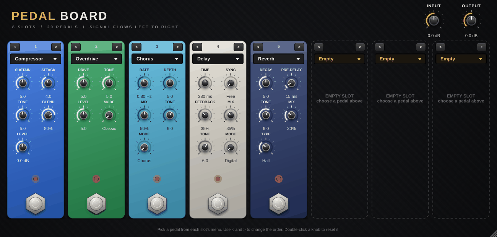

# OAP Pedalboard

Eight pedal slots in one plugin. Each slot can hold any of the
[20 OAP pedals](Pedals.md), and the signal flows from left to right. Handy
when you want a whole board on one track, in a host that makes long plugin
chains fiddly, or as a standalone app for practising.

## Using it

| Control | What it does |
| --- | --- |
| **Pedal menu** (top of each slot) | Picks the pedal for that slot, or **Empty**. Choosing a pedal resets its knobs to that pedal's defaults. |
| **< and >** | Swap the pedal with its neighbour, moving it earlier or later in the chain (knobs and on/off travel with it). |
| **Knobs** | Up to six per slot. Their names, ranges and read-outs follow the pedal in the slot. |
| **Footswitch** | Turns the slot on or off (the LED shows the state). Click-free and latency-compensated. |
| **Input / Output** | -24 ... +24 dB, before the first and after the last slot. |

The default board is **Compressor → Overdrive → Chorus → Delay → Reverb**, with
three empty slots for your own ideas. Changing pedals never interrupts the
audio: new pedals are prepared in the background and swapped in between audio
blocks.

Double-click a knob to reset it, hold **Shift** while dragging for fine
control, and drag the window's corner to resize it.

## Automation and saved sessions

Every slot exposes the same generic parameters to your DAW:
**Slot N Pedal**, **Slot N On** and **Slot N Knob 1-6**. The host shows the
current meaning of each knob in its value read-out (for example *380 ms* or
*Hall*).

> [!NOTE]
> Automation follows the **knob position**, not the pedal. If you automate
> *Slot 3 Knob 1* and then change slot 3 from Chorus to Phaser, the automation
> now moves the Phaser's first knob. Pick your pedals first, automate second.

Your whole board (pedal choices, knob settings, on/off states and window size)
is saved with your project and with your DAW's presets.

## Latency

Only the oversampled drive pedals (Boost, Overdrive, Distortion, Fuzz) add
latency: about 39 samples (0.8 ms at 48 kHz) each. The board reports the total
to your DAW. When you add or remove a drive pedal the total changes; most
hosts pick up the new value immediately, and some only after you stop and
restart playback.

## Technical

- Stereo in, stereo out; a mono input feeds both sides of the board.
- Each slot runs exactly the same code as the matching single pedal plugin.
- Also built as a **standalone app**: pick your audio interface in
  **Options → Audio/MIDI Settings**, unmute the input, and play through the
  board without a DAW (use headphones).
