# OAP Pedals

Twenty stompbox plugins: twelve everyday pedals and eight advanced ones. Each
pedal is its own plugin, so you can chain them on a track in any order, put
them in front of an OAP amp (or any other amp sim), or load them all at once in
the [Pedalboard](Pedalboard.md).

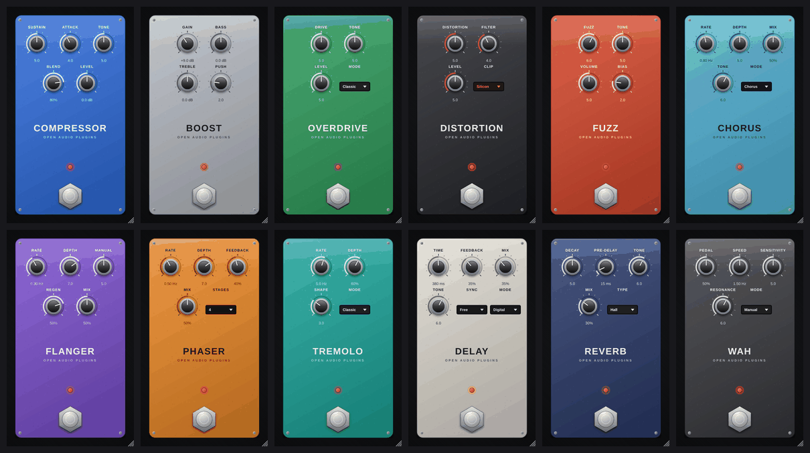

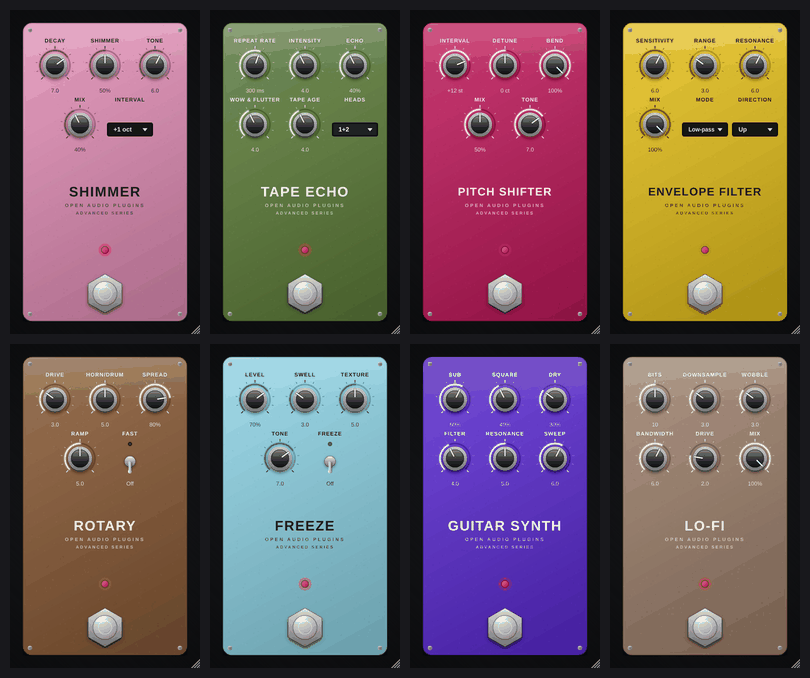

**On every pedal:** click the footswitch to bypass (the LED shows the state;
the bypass is click-free and latency-compensated, and your DAW's own bypass
button controls the same switch). Double-click a knob to reset it, hold
**Shift** while dragging for fine control, and drag the window's corner to
resize. Stereo in → stereo out; a mono input feeds both sides, so stereo
effects can spread it.

| Everyday | | Advanced | |
| --- | --- | --- | --- |
| [Compressor](#compressor) | Dynamics | [Shimmer](#shimmer) | Reverb |
| [Boost](#boost) | Drive | [Tape Echo](#tape-echo) | Delay |
| [Overdrive](#overdrive) | Drive | [Pitch Shifter](#pitch-shifter) | Pitch |
| [Distortion](#distortion) | Drive | [Envelope Filter](#envelope-filter) | Filter |
| [Fuzz](#fuzz) | Drive | [Rotary](#rotary) | Modulation |
| [Chorus](#chorus) | Modulation | [Freeze](#freeze) | Looper-style pad |
| [Flanger](#flanger) | Modulation | [Guitar Synth](#guitar-synth) | Synth |
| [Phaser](#phaser) | Modulation | [Lo-Fi](#lo-fi) | Character |
| [Tremolo](#tremolo) | Modulation | | |
| [Delay](#delay) | Delay | | |
| [Reverb](#reverb) | Reverb | | |
| [Wah](#wah) | Filter | | |

> [!TIP]
> A classic order is: **Wah / Envelope Filter → Compressor → drive pedals → amp → modulation → delay → reverb**.
> Rules are made to be broken: a fuzz after a delay or a reverb into a distortion makes great noise.

---

## Everyday pedals

### Compressor

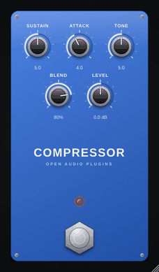

Evens out your picking and adds sustain, with a blend knob for natural attack.

| Control | Range | What it does |
| --- | --- | --- |
| Sustain | 0-10 | Amount of compression. |
| Attack | 0-10 | How quickly it clamps down (about 1-60 ms). Slower lets the pick attack through. |
| Tone | 0-10 | Brightness of the compressed signal. |
| Blend | 0-100 % | Mix of compressed and dry ("parallel compression"). |
| Level | -12 ... +12 dB | Output level. |

 

### Boost

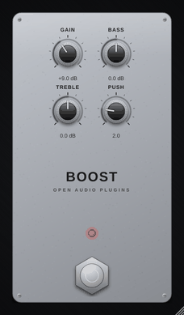

Clean boost with bass and treble shaping; turn up Push to drive your amp harder.

| Control | Range | What it does |
| --- | --- | --- |
| Gain | 0 ... +24 dB | Boost amount. |
| Bass | ±10 dB | Low shelf (120 Hz). Cut it in front of a high-gain amp for tighter chugs. |
| Treble | ±10 dB | High shelf (3 kHz). |
| Push | 0-10 | Lowers the pedal's headroom so it starts to saturate softly. |

 

### Overdrive

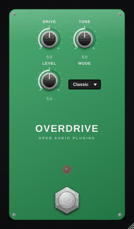

Warm, mid-focused overdrive. Great on its own or to push an amp into tight saturation.

| Control | Range | What it does |
| --- | --- | --- |
| Drive | 0-10 | Amount of overdrive. |
| Tone | 0-10 | Dark to bright. |
| Level | 0-10 | Output level (5 is about unity). |
| Mode | Classic, Open | **Classic:** the famous mid-hump, lows trimmed before clipping. **Open:** fuller lows and more of your clean signal. |

 

### Distortion

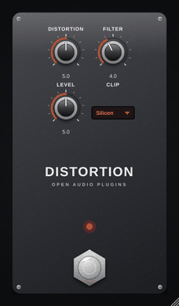

Aggressive hard-clipping distortion with a filter that tames the fizz.

| Control | Range | What it does |
| --- | --- | --- |
| Distortion | 0-10 | Amount of gain. |
| Filter | 0-10 | Dark to bright. |
| Level | 0-10 | Output level. |
| Clip | Silicon, LED, Asymmetric | **Silicon:** tight and compressed. **LED:** more headroom, softer and louder. **Asymmetric:** a rawer, tube-like edge. |

 

### Fuzz

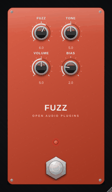

Thick, woolly two-transistor fuzz.

| Control | Range | What it does |
| --- | --- | --- |
| Fuzz | 0-10 | Amount of fuzz. |
| Tone | 0-10 | Blends a dark and a bright filter (the middle scoops the mids). |
| Volume | 0-10 | Output level. |
| Bias | 0-10 | Starves the transistors: higher settings sound gated and sputtery, and notes die abruptly. |

 

### Chorus

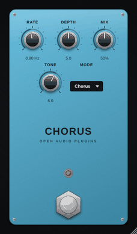

Lush analog-style chorus with vibrato and extra-wide stereo modes.

| Control | Range | What it does |
| --- | --- | --- |
| Rate | 0.1-5 Hz | Modulation speed. |
| Depth | 0-10 | Modulation depth. |
| Mix | 0-100 % | Effect amount (vibrato mode is always fully wet). |
| Tone | 0-10 | Brightness of the chorus voice. |
| Mode | Chorus, Vibrato, Wide | **Vibrato:** pitch wobble only, no dry signal. **Wide:** a second chorus voice and opposite modulation on the left and right channels. |

 

### Flanger

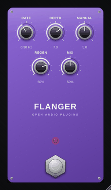

Jet-plane sweeps, from subtle shimmer to metallic regeneration.

| Control | Range | What it does |
| --- | --- | --- |
| Rate | 0.05-5 Hz | Sweep speed. |
| Depth | 0-10 | Sweep width. |
| Manual | 0-10 | Centre of the sweep. With Depth at 0, this is a fixed comb filter. |
| Regen | -95 ... +95 % | Feedback. Negative values sound hollow, positive values metallic. |
| Mix | 0-100 % | Effect amount. |

 

### Phaser

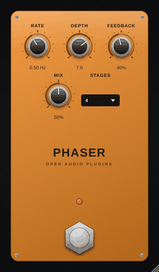

Swirling all-pass phaser with 4 to 12 stages and resonant feedback.

| Control | Range | What it does |
| --- | --- | --- |
| Rate | 0.05-8 Hz | Sweep speed. |
| Depth | 0-10 | Sweep width. |
| Feedback | 0-90 % | Resonance: more makes it more vocal. |
| Stages | 4, 6, 8, 12 | More stages, more notches: 4 is subtle and vintage, 12 is deep and dramatic. |
| Mix | 0-100 % | Effect amount (50 % is the classic phaser sound). |

 

### Tremolo

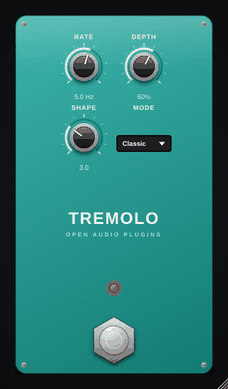

Vintage amp-style tremolo, harmonic tremolo and stereo auto-pan.

| Control | Range | What it does |
| --- | --- | --- |
| Rate | 0.5-15 Hz | Speed. |
| Depth | 0-100 % | Intensity. |
| Shape | 0-10 | From a smooth sine to a choppy square. |
| Mode | Classic, Harmonic, Pan | **Harmonic:** lows and highs pulse in turn, like a brown-panel amp. **Pan:** stereo auto-pan. |

 

### Delay

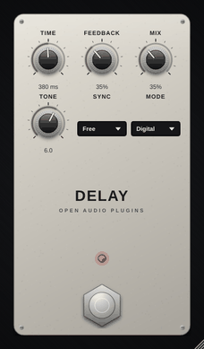

Clean digital, warm analog or ping-pong echoes, free-running or synced to your
song's tempo.

| Control | Range | What it does |
| --- | --- | --- |
| Time | 20-2000 ms | Delay time (when Sync is Free). |
| Sync | Free, 1/2, 1/4, 1/4 dot, 1/8, 1/8 dot, 1/8 trip, 1/16 | Locks the time to your DAW's tempo. |
| Feedback | 0-100 % | Number of repeats. |
| Mix | 0-100 % | Echo level. |
| Tone | 0-10 | Brightness of the repeats. |
| Mode | Digital, Analog, Ping-Pong | **Analog:** repeats get darker and slightly saturated. **Ping-Pong:** repeats bounce between left and right. |

 

### Reverb

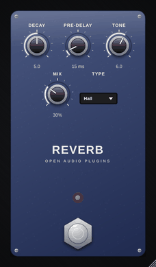

Room, hall, plate and spring reverbs in one pedal.

| Control | Range | What it does |
| --- | --- | --- |
| Decay | 0-10 | Reverb length. |
| Pre-delay | 0-200 ms | Gap before the reverb starts; keeps your attack clear. |
| Tone | 0-10 | Dark to bright. |
| Mix | 0-100 % | Reverb level. |
| Type | Room, Hall, Plate, Spring | Four different reverb algorithms. |

 

### Wah

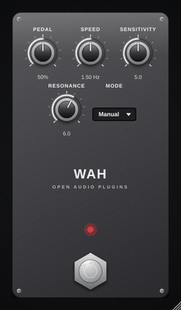

Classic vocal wah. Automate the pedal, or let an LFO or your picking move it.

| Control | Range | What it does |
| --- | --- | --- |
| Pedal | 0-100 % | Pedal position (heel to toe). Automate it or map it to a MIDI expression pedal in your DAW. |
| Mode | Manual, Auto, Envelope | **Manual:** the Pedal knob. **Auto:** an LFO rocks the pedal. **Envelope:** your picking dynamics move it. |
| Speed | 0.1-8 Hz | LFO speed in Auto mode. |
| Sensitivity | 0-10 | How strongly your picking moves the pedal in Envelope mode. |
| Resonance | 0-10 | How vocal and peaky the filter is. |

 

---

## Advanced pedals

### Shimmer

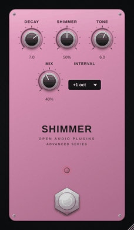

Huge ambient reverb whose tail rises into octaves: instant cathedral pads.

| Control | Range | What it does |
| --- | --- | --- |
| Decay | 0-10 | Reverb length (very long at the top). |
| Shimmer | 0-100 % | How much of the tail is pitch-shifted. |
| Interval | +1 oct, +5th, +1 oct +5th, +2 oct, -1 oct | The pitch the tail climbs (or falls) to. |
| Tone | 0-10 | Dark to bright. |
| Mix | 0-100 % | Reverb level. |

 

### Tape Echo

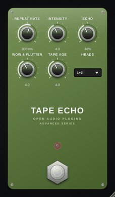

Three playback heads, wobbly tape and saturated repeats that can run away into self-oscillation.

| Control | Range | What it does |
| --- | --- | --- |
| Repeat Rate | 50-700 ms | Tape speed (time between head 1 and the record head). |
| Intensity | 0-10 | Repeats. Near the top it self-oscillates; turn it back down to tame it. |
| Echo | 0-100 % | Echo level. |
| Heads | 1, 2, 3, 1+2, 2+3, 1+2+3 | Which playback heads you hear, for different rhythmic patterns. |
| Wow & Flutter | 0-10 | Tape speed wobble. |
| Tape Age | 0-10 | Older tape: darker, duller repeats. |

 

### Pitch Shifter

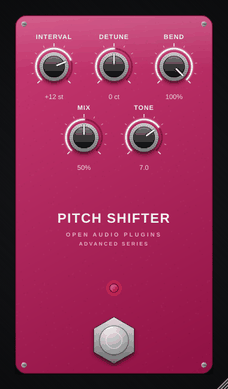

Octaves, harmonies and whammy-style bends.

| Control | Range | What it does |
| --- | --- | --- |
| Interval | -24 ... +24 semitones | Target pitch. |
| Detune | ±50 cents | Fine tuning; a few cents with Mix 50 % gives a thick doubling effect. |
| Bend | 0-100 % | How far towards Interval the pitch goes. Automate it for dive bombs and whammy squeals. |
| Mix | 0-100 % | Shifted voice level (100 % = shifted only). |
| Tone | 0-10 | Brightness of the shifted voice. |

 

### Envelope Filter

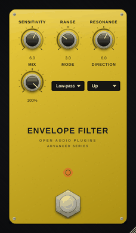

Funky auto-wah that sweeps with your picking dynamics, up or down.

| Control | Range | What it does |
| --- | --- | --- |
| Sensitivity | 0-10 | How strongly your picking opens the filter. |
| Range | 0-10 | Starting frequency of the sweep. |
| Resonance | 0-10 | Quack. |
| Mode | Low-pass, Band-pass, High-pass | Filter type. |
| Direction | Up, Down | Sweep up (classic) or down (backwards) as you pick harder. |
| Mix | 0-100 % | Effect amount. |

 

### Rotary

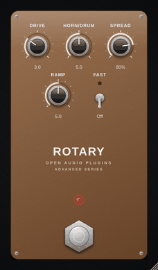

Rotating speaker cabinet with slow/fast speeds that spin up and down realistically.

| Control | Range | What it does |
| --- | --- | --- |
| Fast | Off / On | Switches between chorale (slow) and tremolo (fast). Automate it for the classic speed-up. |
| Drive | 0-10 | Overdrive of the cabinet's amplifier. |
| Horn/Drum | 0-10 | Balance between the treble horn and the bass drum. |
| Spread | 0-100 % | Stereo width of the microphones. |
| Ramp | 0-10 | How long the rotors take to speed up and slow down. |

 

### Freeze

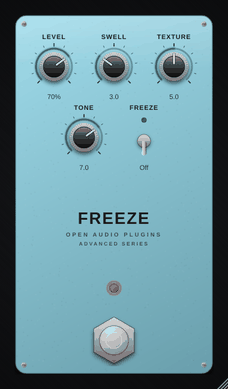

Hit Freeze to hold whatever you just played as an endless pad, then play over it.

| Control | Range | What it does |
| --- | --- | --- |
| Freeze | Off / On | On: captures the last moment of sound and sustains it. Off: lets it fade out. |
| Level | 0-100 % | Pad level. |
| Swell | 0-10 | How slowly the pad fades in (about 0.03-3 s). |
| Texture | 0-10 | Smooth to grainy, with slight detuning. |
| Tone | 0-10 | Dark to bright. |

 

### Guitar Synth

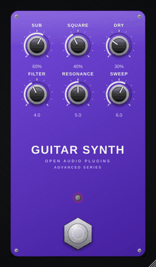

Turns single notes into a fat analog synth with sub-octave and an envelope-swept filter.

| Control | Range | What it does |
| --- | --- | --- |
| Sub | 0-100 % | Square wave one octave down. |
| Square | 0-100 % | Square wave at the played pitch. |
| Dry | 0-100 % | Your guitar. |
| Filter | 0-10 | Filter cutoff. |
| Resonance | 0-10 | Filter resonance. |
| Sweep | 0-10 | How far your picking sweeps the filter open. |

Play single notes: like a hardware guitar synth, it tracks one note at a time.

 

### Lo-Fi

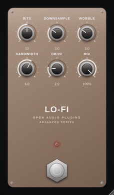

Old samplers, worn tapes and cheap speakers: crush bits, drop the sample rate and add wobble.

| Control | Range | What it does |
| --- | --- | --- |
| Bits | 4-16 | Bit depth. |
| Downsample | 0-10 | Sample-rate reduction (aliasing on purpose). |
| Wobble | 0-10 | Tape-style pitch wobble. |
| Bandwidth | 0-10 | Narrow (telephone) to full range. |
| Drive | 0-10 | Saturation. |
| Mix | 0-100 % | Effect amount. |

 

---

## Technical

- Stereo in, stereo out (mono in works too). All pedals report their latency
  and tail to the host. The drive pedals are oversampled and add about
  39 samples (0.8 ms at 48 kHz) of latency; the others add none.
- Each pedal is the same effect code that runs in the Pedalboard and inside the
  effect amps, in [`shared/fx/`](../../shared/fx/).
